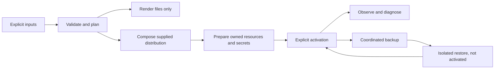

# Getting started with Infra Layer

`@drumee/infra-layer` is Drumee's reusable infrastructure library. It turns
explicit infrastructure requirements into validated plans, renders configuration,
and provides an owner-bound Docker lifecycle for supplied distributions.

Use it when building a composition host or distribution that needs infrastructure
without absorbing application identity, authorization or storage policy. To
install the already integrated Minimal Kernel, follow the
[Debian minimal-kernel guide](/kernel/distribution/install).

## Responsibilities

| Owner | Responsibilities |
|---|---|
| Infra Layer | Infrastructure planning, Docker composition/activation, infrastructure secrets, TLS, DNS, MariaDB, Redis, outbound SMTP, observation and recovery mechanics |
| Distribution or host | Explicit configuration, immutable images, initialization jobs, application SQL grants, resource ownership, operator workflow and application readiness |
| Control plane | Platform bootstrap, human enrollment, administrator policy and Hub lifecycle/provisioning authorization |
| Server Runtime | Authentication, sessions, authorization routing and native service dispatch |
| Capabilities | Their operational schemas, migrations, MFS behavior and application services |

Infra Layer creates no human administrator or Hub and supplies no session or ACL
engine. It does not replace the distribution installer. Its npm package contains
the library and declarations; Docker images and system executables are separate
inputs.

## Requirements and installation

Use **Node.js 22 or newer** and npm. The pure planning example below needs only
Node/npm; rendering additionally writes to an owned local directory. Actual
execution uses Linux, local Docker Engine, the Compose plugin, `ss` and OpenSSL.
DNS/mail services need their explicit supplied tools image; ACME additionally
requires the supported external `lego` executable and provider credentials.

Create an example project under an owned, non-shared parent:

```bash
mkdir -m 700 infra-example
cd infra-example
npm init -y
npm install --save-exact @drumee/infra-layer@0.1.0-alpha.2
```

Commit the resulting package lock in your own project. Infra Layer alpha.2 is a
CommonJS package with TypeScript declarations and zero production npm
dependencies. Registry verification on **2026-10-16** finds `next` at alpha.2 and
`latest` at alpha.1; use the explicit version rather than a movable tag. Published
alpha.1 does not contain the qualified lifecycle APIs.

The alpha.2 tarball has 39 allowlisted files and this integrity:

```text
sha512-KuNELBJcKBA69RN65qoej4Wxw+lMN5NJO5d50ooHwydZMB90Rq42MyavDgOwpWqG12bPKjJKH0b01tvN17nsnw==
```

Its npm `gitHead` is `bef9a379754bcf9a46fed8bcb6f88fe1f775c739`. The published
tarball matches the IL-4-qualified candidate byte-for-byte. See
[release and qualification evidence](/kernel/distribution/qualification).

## 1. Validate, plan and render

Three explicit inputs define a plan:

- **`spec`** declares the instance and infrastructure capabilities.
- **`requirements`** declares what the consuming host needs.
- **`adapter_input`** declares concrete Docker images, ownership, paths and bindings.

`validateSpec` and `planInfrastructure` are pure: they do not inspect the host,
generate credentials, access the network or start a process. A supplied
observation can describe known port conflicts. `renderPlan` writes verified
configuration artifacts and an ownership manifest; it does not activate them.

Save the following as `plan.cjs`. It uses the version-2 contract to describe a
private, ephemeral Redis service. This is a planning exercise: the image is
digest-pinned, but neither an image pull nor a Redis container is started.

```js
const path = require('node:path');
const {
  validateSpec, planInfrastructure, renderPlan,
} = require('@drumee/infra-layer');

const workspace = path.resolve('workspace');
const auth = { resource: 'redis', key: 'auth' };

const spec = {
  contract_version: '2',
  instance: { id: 'infra-example' },
  http: { enabled: false, https: false },
  dns: { mode: 'none' },
  secrets: {
    store_resource: 'infrastructure-secrets',
    resources: [{ ref: auth, type: 'redis-auth', consumers: ['redis'] }],
  },
  redis: {
    mode: 'managed',
    endpoint: { host: 'redis', port: 6379, transport: 'tcp' },
    auth_secret_ref: auth,
    persistence: 'ephemeral',
  },
};

const requirements = { contract_version: '2', capabilities: ['redis'] };
const adapter = {
  kind: 'docker-services',
  project: 'infra-example',
  network: 'infra-example-kernel',
  services: {
    redis: {
      image: 'redis@sha256:ff02b58f971e7d7d156a1267e283fcbbeee91773b6aa36c49dac28ecfe28eadf',
      uid: 1000,
      gid: 1000,
      listen_port: 6379,
      bindings: [],
    },
  },
  resource_sources: [{
    ref: auth,
    source: path.join(workspace, 'deployment/projections/redis-auth'),
  }],
};

const validation = validateSpec(spec, requirements);
if (!validation.valid) {
  console.error(validation.diagnostics);
  process.exit(1);
}

const plan = planInfrastructure(spec, requirements, adapter, { ports: [] });
if (!plan.applicable) {
  console.error({ diagnostics: plan.diagnostics, conflicts: plan.conflicts });
  process.exit(1);
}

const output = renderPlan(plan, path.join(workspace, 'rendered'));
console.log({ revision: output.revision, files: output.files, activated: output.activated });
```

Run it:

```bash
node plan.cjs
```

The result includes a revision, paths to `redis.compose.json` and `redis.conf`,
and **`activated: false`**. Repeating the command with unchanged inputs preserves
the revision and rendered bytes. No Redis password has been generated yet: the
plan contains the reference `{ resource: 'redis', key: 'auth' }`, not its value.

The example's UID/GID `1000:1000` is an explicit illustrative choice. For actual
execution, use the intended host owner and verified image user. An empty supplied
port observation is not a host availability check. Here `bindings: []` declares
no host publication. The workspace paths are explicit absolute paths derived
from this example's working directory; move the project only with a new plan.

Unknown fields, unsupported contracts, raw secret values, accessors and cyclic
inputs are rejected. Inspect `validation.diagnostics`, `plan.diagnostics`,
`plan.conflicts` and `plan.prerequisites` rather than treating a generated file
as proof that the application can run. Rendering refuses unsafe paths, unowned
destinations, edited owned artifacts and concurrent writers.

## 2. Select capabilities explicitly

Use matching `contract_version: '2'` in the spec and requirements for current
multi-capability plans, with `kind: 'docker-services'` adapter input. The original
version-1 gateway contract remains compatible, but it is not the multi-service
lifecycle input. Lifecycle `Distribution` records separately use version `'1'`;
those version numbers describe different contracts.

| Capability name | Main configuration | Boundary |
|---|---|---|
| `http-gateway` | Explicit backend listeners, public assets, protected artifact view, host bindings and pinned Nginx image | Service/WebSocket proxying and FileIo delegation; the host supplies application listeners |
| `tls` | `provided`, persistent `local` CA, or supported DNS-01 `acme` configuration | Secret references and certificate validation; renewal is an explicit lifecycle action |
| `dns` | Local address, serial, authorized client CIDRs, listeners, recursion policy and optional TSIG | BIND9 authoritative zone; no host resolver modification |
| `database` | Managed or external MariaDB, explicit endpoint, engine series `11.4`, account references and state resource | Accounts and engine readiness; schema/grant policy stays with its owner |
| `redis` | Managed or external service, auth reference, ephemeral or AOF persistence | Credential projection, protocol health and persistent state when selected |
| `smtp` | Capture/relay mode, endpoints, TLS/auth references, queue and optional DKIM | Outbound submission/relay; not a mailbox or identity service |

Persistent MariaDB and Redis AOF require explicit state resources. Declare all
durable application resources too, so recovery inventories can cover them.
For local LAN deployments, supply the actual host LAN address and interface
through the distribution; a container address is not an externally reachable
host address. The qualified minimal profile explicitly uses `drumee.lan`, local
DNS and the persistent local CA. Do not request a public ACME certificate for
that local name. The current ACME contract supports Cloudflare DNS-01 and
explicit Let's Encrypt staging/production directory selection.

## 3. Keep secret values out of plans

A secret reference is an opaque `{ resource, key }` pair. Version-2 specs declare
the type and authorized consumers under `secrets.resources`. Values belong to
the private filesystem secret store, with explicit consumer projections.

The low-level `@drumee/infra-layer/capabilities/secrets` subpath exports
`createFilesystemSecretStore`. Its operations distinguish `ensure`, `import`,
`inspect`, consumer-authorized `read`/`materialize`, and explicit `rotate`.
Rotation checks the expected fingerprint and declared consumer transition.
For managed deployments, use the lifecycle to coordinate consumers rather than
changing a secret file underneath a running service.

Keep resource roots private and operator-owned. Generated passwords and keys
must not appear in spec objects, Compose environment values, logs, images or
source control. Imported external credentials use protected owned files.
Preserve the existing store and generations across restart; ownership mismatch,
corruption or incomplete state requires investigation, not blind replacement.

`database.accounts` supports additional `{ user, secret_ref }` accounts. Infra
Layer creates absent accounts and verifies existing credentials without resetting
them or assigning application SQL grants. Each reference must declare the proper
database-service consumer. A distribution can therefore separate schema,
enrollment, provisioner and runtime accounts; see the
[real minimal-profile SQL matrix](/kernel/distribution/sql-security).

## 4. Compose, prepare and activate separately



Import the operational API through the explicit subpath:

```js
const lifecycle = require('@drumee/infra-layer/lifecycle');

// Integration template: the caller supplies reviewed version-2 plan inputs,
// a complete Distribution descriptor, and a private owned deployment root.
async function activateReviewedDistribution(plan, distribution, root) {
  const composition = lifecycle.composeDeployment(plan, distribution);
  const context = { root, authorized: true, create_resources: true };
  const prepared = await lifecycle.prepareDeployment(composition, context);
  const state = await lifecycle.activateDeployment(prepared, context);
  if (!state.ready) throw new Error('DISTRIBUTION_NOT_READY');
  return { prepared, state };
}
```

This function performs mutations **when invoked**. It is an integration template,
not the next command for starting the planning example. A complete descriptor
and explicit activation decision are required; there is no implicit `applyPlan`.
For a ready-made real-kernel descriptor and operator orchestration, use the
[minimal-kernel profile](/kernel/distribution/install).

A `Distribution` supplies its logical ID, `infrastructure` or `kernel` profile,
immutable helper image, initialization jobs, persistent resources, schema
versions, provenance and explicit `external_writers: 'none'`. Kernel profiles
also supply the kernel host and its health/listener contract. Initialization
jobs declare idempotent effects, artifact revisions and validation commands.
`services` admits separately owned private services, such as a Hub provisioner;
they cannot publish extra application ports, and the kernel must depend on them.

`composeDeployment` is pure and verifies plan integrity. Preparation validates
images and ownership, creates authorized resources and secret projections, and
writes candidate/journal state. It does not start daemons. Activation checks
ownership and bindings, brings up infrastructure in order, executes and validates
jobs, then checks the supplied host/gateway. Initialization SQL and human
enrollment still execute through their canonical owners.

## 5. Observe what is actually ready

| API | Use |
|---|---|
| Root `inspectInfrastructure(deployment, adapter)` | Observe the exact plan through the supplied read-only adapter |
| Root `diagnoseInfrastructure(state, requirements)` | Report readiness and capability diagnostic codes |
| Lifecycle `inspectDeployment(root, context)` | Observe an owned prepared/active composition and its services |
| Lifecycle `diagnoseDeployment(state)` | Report deployment readiness, diagnostic codes and acceptance classification |

The remaining root APIs are `validateSpec`, `planInfrastructure` and `renderPlan`.
Do not replace observation with an unconditional `ready: true` adapter.
Resource presence, a running process, configuration validity, desired revision,
loaded-configuration evidence and a successful protocol probe are different
facts. Infrastructure health alone does not prove administrator authentication,
Hub/MFS ACLs or browser readiness. Acceptance provenance distinguishes
infrastructure, contract-fixture and real-kernel evidence.

Machine-readable error codes include `PLAN_NOT_APPLICABLE`,
`RENDER_DESTINATION_UNOWNED`, `RENDER_LOCKED`, `UNOWNED_DEPLOYMENT_DIRECTORY`,
`IMAGE_DIGEST_MISMATCH` and `COMPOSITION_TAMPERED`. Investigate the ownership,
inputs or interrupted writer corresponding to the code; do not bypass the guard
or adopt an unknown existing deployment. Exclusive lifecycle locks are not
automatically stolen after a timeout.

## 6. Backup, restore and controlled transitions

Lifecycle operations retain explicit authorization and ownership:

| API | Guarantee or required decision |
|---|---|
| `stopDeployment(prepared, context)` | Stop owned services and preserve persistent data |
| `backupDeployment(root, directory, context)` | Quiesce owned writers, validate managed SQL event quiescence, capture its locked dump and cold persistent resources with protected inventory |
| `validateBackup(directory, schemaVersions, context)` | Validate inventory, checksums and expected schemas |
| `restoreDeployment(directory, composition, context)` | Restore into a new isolated owned project; returns `activated: false` and `kernel_recovery_verified: false` |
| `classifyChanges(active, prepared)` | Classify compatibility before activation |
| `rollbackDeployment(root, revision, context)` | Return to a verified compatible prepared revision |
| `rotateSecret` / `resumeSecretRotation` | Coordinate supported consumers and durable interruption recovery |
| `renewDeployment` / `renewalTrigger` | Explicit certificate renewal and due-state inspection; no automatic scheduler installation |

For backup, explicitly choose `quiescence: 'stop-owned-writers'` and whether to
resume afterward with `resume_after_backup`. Include application-owned SQL/MFS,
configuration, credentials, secret generations and CA state in the distribution
inventory. The backup itself is private sensitive material. Do not use a
database-only dump as proof of complete application recovery.

Restore uses a separate project, a new empty owned root and loopback-only high
ports. Activation and real authentication/ACL/MFS/browser validation follow as
separate steps. Unsupported engine downgrade, schema change, kernel-image change
or secret-generation mismatch must fail closed; switching an image does not
reverse a SQL migration. Additional SQL-account secret rotation has no qualified
consumer transition. SMTP queue recovery remains outside the fully qualified
minimal-kernel recovery scope.

## Continue

- [Install the integrated Minimal Kernel](/kernel/distribution/install).
- [Operator commands and complete recovery](/kernel/distribution/operations).
- [SQL privilege separation](/kernel/distribution/sql-security).
- [IL-4 versions, test counts, failures and scope limits](/kernel/distribution/qualification).
- [Canonical Infra Layer repository](https://github.com/drumee/infra-layer).
- [Published package](https://www.npmjs.com/package/@drumee/infra-layer/v/0.1.0-alpha.2).
- [Versioned root declarations](https://github.com/drumee/infra-layer/blob/bef9a379754bcf9a46fed8bcb6f88fe1f775c739/index.d.ts) and [lifecycle declarations](https://github.com/drumee/infra-layer/blob/bef9a379754bcf9a46fed8bcb6f88fe1f775c739/lifecycle/index.d.ts).

The planning example was executed against the published alpha.2 package,
including identical replay, without Docker activation or credential generation.
The integration template describes the public lifecycle API; it does not claim
that this guide itself reran the heavy distribution qualification suites.
