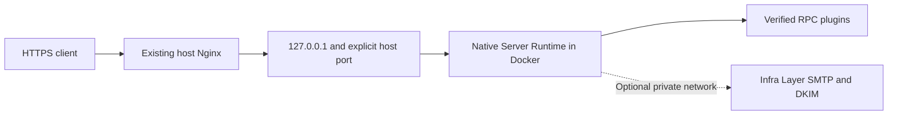

# Run a minimal application behind host Nginx

Choose `minimal-application` when your application needs native Server Runtime
RPC behind an existing HTTPS reverse proxy. Debian supplies the operator profile;
[Infra Layer](/getting-started/infra-layer) owns infrastructure planning,
composition, resources and lifecycle. Server Runtime remains exactly
`0.1.0-alpha.4`.

The base composition starts one application container. Hub, MFS, Finder,
MariaDB, Redis, local DNS and a containerized HTTP gateway are not implicit.
SMTP/DKIM is an explicit optional capability. For platform administrator
enrollment, Hubs, MFS and Finder, use the separate
[minimal-kernel profile](/kernel/distribution/install).



## Status and prerequisites

IL-5.9-B reached **READY_FOR_OWNER_MERGE_DECISION** after integrated acceptance.
This status is technical evidence, not production support or a release. As
observed on **2026-10-19**, Debian PR #7 is merged into
`feat/container-distribution`; Infra Layer PR #2 remains open. Debian main has
not been selected as this profile's installation reference. The source dependency
is immutable even while the upstream PR remains open.

Published Infra Layer alpha.2 does not provide the application profile.
The alpha.3 npm package is a locally qualified candidate, not the selected
registry dependency. Debian acquires the qualified GitHub source with its own
archive integrity. See [source and qualification records](/kernel/distribution/application-qualification).

Use Linux/amd64, Node.js 22, npm, Git, Python 3, Docker Engine and its Compose
plugin. Run as a normal, Docker-authorized operator. Provision an owned persistent
root, separate backup location, immutable application/plugin artifacts and an
available loopback host port. An existing host Nginx and valid HTTPS certificates
are required for external HTTPS. Certificate renewal belongs to that proxy's
operator; this profile does not install a host CA or manage Nginx.

## 1. Acquire the locked distribution

```sh
git clone --branch feat/container-distribution https://github.com/drumee/debian.git
cd debian
git checkout --detach 490c4b0a28ffb35da6ff248402139b5f600c793f
npm ci --ignore-scripts --no-audit --no-fund --prefix profiles/minimal-application
```

This exact Debian delivery contains the executable tree qualified at
`ccaa839bf13ab163025e868b21f16516c87d1ff9`; subsequent commits only add evidence
and documentation. It pins Infra Layer source
`aa9057f224f4ae5cf80d777e3cb2fad092193fb1`. npm verifies the source SRI; the
builder also checks the installed bytes of all 40 allowed Infra package members.
Runtime version, integrity and production dependency lock remain fixed.
No neighboring Infra checkout or published alpha.3 package is needed.

Keep `profiles/minimal-application/infra-source-lock.json` and package-lock.json
with the checkout. A source archive SRI and an npm package SRI identify different
bytes and cannot replace one another. Do not select a floating branch or `latest`.

## 2. Declare the owned configuration

```sh
install -d -m 700 "$HOME/drumee-application-config"
cp config/drumee.minimal-application.example.json \
  "$HOME/drumee-application-config/application.json"
```

Edit the copy. The example's zero image/revision fields and `/owned/` paths are
placeholders; it is not ready to activate unchanged. JSON is accepted by the
shared configuration reader. Select `distribution.profile: minimal-application`
explicitly; Team remains the default and minimal-kernel keeps its own lock.

| Input | Operator decision |
|---|---|
| `deployment` | Logical ID, Docker project, actual host owner UID/GID; ordinary deployments keep `acceptance: false` |
| `storage` | Owned absolute persistent root, separate backup location and explicit retention days |
| `infrastructure` | Canonical spec/requirements/adapter input; empty capabilities and services for the base application |
| `manifest.application` | Immutable image, non-root user, command, verified plugins, listener, dependencies, healthcheck and explicit mounts |
| `manifest.persistent_resources` | Application data and operator-state resources with correct ownership and backup policy |
| `manifest.external_gateway` | Internal container port, distinct available host port, exact loopback binding and external TLS ownership |
| `manifest.provenance` | Source revision from the build receipt and the supplied artifact provenance |

The example uses internal port `3101` and loopback host port `28971` as explicit
illustrations. Choose an available host port; these numbers are not inferred
from the container or guaranteed free. The required ingress shape is:

```json
{
  "kind": "host-loopback",
  "protocol": "http",
  "host_address": "127.0.0.1",
  "host_port": 28971,
  "container_port": 3101,
  "route_prefix": "/-/",
  "rpc_prefix": "/-/svc/",
  "tls_termination": "external",
  "readiness_path": "/-/svc/health.ready"
}
```

Match `container_port` to the application listener. Public/wildcard/LAN/IPv6
bindings and a competing managed gateway are refused. `http.enabled: false` in
the infrastructure spec means no Infra-managed gateway, while host Nginx still
owns HTTPS. Secrets use canonical references and protected import files, never
password command-line arguments or plaintext Compose/configuration values.

## 3. Build the runtime and verified plugins

Package each native plugin as an immutable npm archive containing its `server/`
workers and `server/acl/*.json` descriptors. Bundle its dependencies with
`bundledDependencies`. Record the archive's SRI and actual immutable source
revision. The builder validates members, integrity, bounds and native ACL
presence before assembly; it does not run plugin install scripts.

Create a separate build-input.json, replacing all illustrative plugin fields:

```json
{
  "tools": false,
  "plugins": [
    {
      "id": "example",
      "archive": "/absolute/owned/artifacts/example-plugin.tgz",
      "integrity": "sha512-REPLACE_WITH_VERIFIED_ARCHIVE_SRI",
      "revision": "REPLACE_WITH_IMMUTABLE_PLUGIN_SOURCE_REVISION"
    }
  ]
}
```

An explicit empty `plugins` list builds a health-only host. `tools: true` also
builds the canonical Infra native-tools image for explicitly selected SMTP/DKIM.
It does not enable those services by itself.

```sh
node profiles/minimal-application/scripts/build.js \
  "$HOME/drumee-application-config/build-input.json"
```

Profile source must be committed. The base image is digest-pinned; production
installation uses the locked Runtime package. No image is pushed.
`profiles/minimal-application/.cache/images.json` records the Debian/Infra
revision and integrity, image IDs and verified plugin inventory. Set
`manifest.application.image` to its `image`, `manifest.application.plugins` to
its `plugins`, and `manifest.provenance.revision` to its `revision`. If selected,
use the returned tools image through the canonical mail/DKIM adapter inputs.

The documented acceptance image contains a disposable qualification plugin.
Build your own application artifacts; it is not a published application image.
Changing the Debian revision or plugin changes image labels/identity and requires
appropriate consumer acceptance.

## 4. Validate, plan and activate

```sh
bin/drumee-ctl --profile minimal-application validate \
  --config "$HOME/drumee-application-config/application.json"
bin/drumee-ctl --profile minimal-application plan \
  --config "$HOME/drumee-application-config/application.json"
bin/drumee-ctl --profile minimal-application install --execute \
  --config "$HOME/drumee-application-config/application.json"
```

Planning does not activate services. Installation delegates preparation and
activation to the public Infra lifecycle, persists a protected configuration
snapshot and verifies native readiness. Mutation requires `--execute` and the
configured owner. Unknown nonempty roots/resources, ownership mismatches and
mutable or missing images fail closed.

The supplied host uses Runtime's native descriptor registry, dispatcher,
authorizer and service server. It creates no human account and implements no
second session/password system. Its reference composition serves public RPC;
protected scopes without their canonical authorization adapters remain denied.

## 5. Connect the existing HTTPS proxy

```sh
bin/drumee-ctl --profile minimal-application proxy-config \
  --config "$HOME/drumee-application-config/application.json"
```

This returns a JSON `content` fragment for review and inclusion in your existing
HTTPS server. It does not write host configuration or reload Nginx. The generated
upstream has this form, using the configured host port:

```nginx
location /-/ {
  proxy_pass http://127.0.0.1:28971;
  proxy_http_version 1.1;
  proxy_set_header Host $host;
  proxy_set_header X-Forwarded-Proto $scheme;
  proxy_set_header X-Forwarded-For $remote_addr;
}
```

Keep `proxy_pass` without a URI suffix: the full `/-/svc/module.method` path
must reach the native dispatcher. Use valid certificates for the external host;
verify the CA and SAN rather than disabling TLS validation. Check native
`POST /-/svc/health.ready` and your application's public/protected RPC behavior.
Also inspect Docker's actual publication and host sockets, and test from an
independent LAN client. A host-only HTTP success does not prove LAN isolation.

## 6. Operate and recover

Use the same explicit profile/config options for each command:

| Command | Required inputs and effect |
|---|---|
| `status`, `doctor` | JSON observation and diagnostics |
| `stop`, `start`, `restart` | `--execute`; persistent data is retained |
| `backup` | `--execute --backup /owned/backups/snapshot`; coordinated no-SMTP backup |
| `restore` | `--execute --backup /owned/backups/snapshot`; a separate target config/project/root/port, then explicit operator activation |
| `rollback` | `--execute --revision VERIFIED_PREPARED_REVISION`; compatible stored configuration only |
| `start --recover` | `--execute`; acknowledge an investigated interrupted activation |

Stop/restart/backup require the active configuration. An exclusive lock from an
interrupted process is never automatically stolen; establish ownership and that
the writer is dead before any recovery decision. Preserve durable state and
secret generations. Rollback is not a schema reversal or an arbitrary image/
engine downgrade. Restore's `kernel_recovery_verified: false` does not qualify
Hub/MFS/Finder recovery in this application profile.

## Optional SMTP/DKIM

Declare the canonical TLS/mail spec, secret references, queue resources, native
image and adapters explicitly. The application receives only authorized
submission credentials and a CA-only projection. DKIM uses a private internal
network; no host SMTP/DKIM publication is needed. Required SMTP affects readiness;
optional SMTP failure can leave the HTTP application ready with diagnostics.

Use mandatory STARTTLS and verify the CA and server name. Trusted network CIDRs
and SASL are separate authorization paths; selecting SASL does not revoke a
trusted CIDR relay grant. No parallel mail stack or direct-MX fallback is added.
Application backup/restore with SMTP remains refused with
`SMTP_RECOVERY_UNQUALIFIED`. Queue persistence through restart is not spool
recovery. Real upstream submission, SPF/DKIM/DMARC, controlled inbox reception
and bounces require application-specific qualification.

## Continue

- [IL-5.9-B versions, integrity, results and current review limits](/kernel/distribution/application-qualification).
- [Infra Layer planning and lifecycle](/getting-started/infra-layer).
- [Canonical Debian operator guide](https://github.com/drumee/debian/blob/490c4b0a28ffb35da6ff248402139b5f600c793f/docs/IL-5-distribution.md).
- [Canonical configuration example](https://github.com/drumee/debian/blob/490c4b0a28ffb35da6ff248402139b5f600c793f/config/drumee.minimal-application.example.json).

This documentation update does not rerun the deployment acceptance, resume
Oxy-form, qualify Internet mail or start Oxymotion D0.
