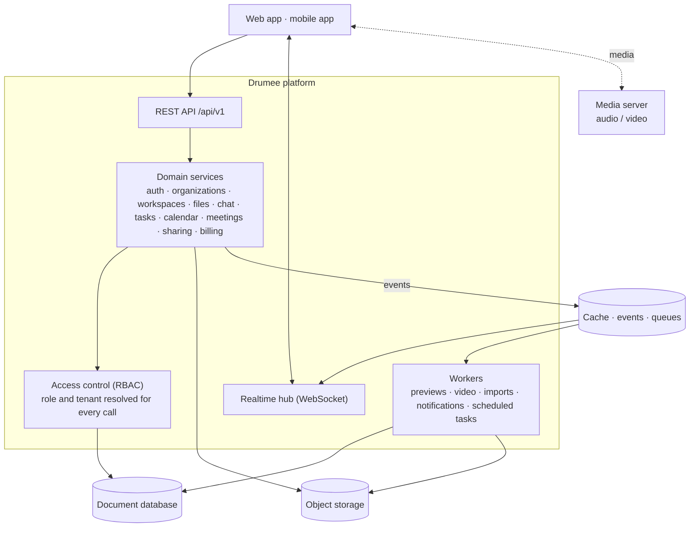

# Technology Overview

Drumee puts files, conversations, tasks and meetings in one workspace, under one permission model. This page is the map: what the platform is made of, and where to read about each part.

## Architecture at a glance



A request enters through the API, reaches the service of its domain, and **every** service resolves the caller's role and tenant before it reads or writes anything. Changes are published as events, which the realtime hub delivers to the people who should see them and which workers turn into notifications and background work.

## The core components

### 1. Access control

One role per person per workspace, on a ladder from Viewer to Owner; a separate ladder for administering an organization; and share links for people outside. All decisions are made on the server, next to the code that performs the action.

→ [RBAC System](./02-rbac-system.md)

### 2. File storage

A file is a record in the database and an object in S3-compatible storage. Browsers upload directly to storage; the server authorizes, verifies and records. Previews, video renditions, versions, trash and quota are built on that split.

→ [File Storage](./03-file-storage.md)

### 3. The request pipeline and realtime

One middleware chain, one error format, one event bus. Every change becomes an event that reaches the other members of the workspace over WebSocket, with replay after a reconnection.

→ [Request Pipeline](./04-request-pipeline.md)

### 4. Data and its protection

A document database is the source of truth, object storage holds content, and a cache holds what can be rebuilt. Tenants are separated in every query. Secrets are hashed or encrypted; end-to-end encryption is on the way.

→ [Data Storage & Encryption](./05-data-storage-encryption.md) · [Directory Schema](./06-directory-schema.md)

## Key architectural properties

### One binary

The platform is a **modular monolith**: a single program that runs as an API server, as a background worker, or as a migration job. Each domain — files, chat, tasks, … — is a self-contained module with the same internal layering (handler, service, repository) and explicit boundaries, but they are built, tested and deployed together. There is no fleet of services to version against each other.

### Stateless servers

No server keeps files on its disk or sessions in its memory. Durable state is in the database and in object storage; shared short-lived state is in the cache. Servers and workers can be added, removed or replaced freely, and several of each run side by side.

### The server decides

Permissions and plan limits are enforced on the server for every request. The interface shows or hides controls according to what the server reports; it is never the thing that protects data.

### Tenant isolation by construction

Every document that belongs to an organization carries its tenant ID, every data-access function must filter by it, and a check in the build rejects code that does not. The tenant is derived from the resource being accessed, not supplied by the client.

### Nothing is deleted by accident

Deleting a file, a workspace or an account is a soft delete with a 30-day window. Every failed action reports an error and restores the previous state.

### A contract-first API

The REST API is described by an OpenAPI contract, and the web application's client types are generated from it. The web app uses exactly the API that integrations will use.

## The tenant — the unit of ownership

A **tenant** owns data. Every person has a personal tenant; an organization is a tenant shared by its members. A tenant contains **workspaces**, and a workspace is the unit of collaboration:

```
Tenant (personal or organization)
  ├── Workspace A   → file tree · conversation and topics · task board · calendar · members with roles
  ├── Workspace B
  └── Workspace C
```

| Workspace kind | Who can be a member |
| :---- | :---- |
| Personal | Its owner |
| Internal | Members of the organization |
| External | Members of the organization and invited people from outside |

Storage quota, seats and features are counted per tenant. People from outside an organization can hold a role in one of its external workspaces without belonging to it.

## Technology stack

| Layer | Technology |
| :---- | :---- |
| Application | Go — one binary: `server`, `worker`, `migrate` |
| Web application | React and TypeScript, built with Vite |
| API | REST (`/api/v1`) with an OpenAPI contract; WebSocket for realtime |
| Database | MongoDB (replica set) |
| Object storage | Any S3-compatible store |
| Cache, events, job queues | Redis |
| Audio and video | LiveKit (WebRTC) |
| Office documents | Drumee's own office engine, running in the browser, with realtime co-editing |
| Media processing | Background workers; ffmpeg for video |
| Edge | A reverse proxy terminating TLS |
| Languages of the interface | English, French, German, Vietnamese |

## What is not here yet

| Topic | Status |
| :---- | :---- |
| [SDK Reference](/api-reference) | Coming soon |
| [Self-Hosting](/self-hosting) | Coming soon |
| End-to-end encryption | In development — see [Data Storage & Encryption](./05-data-storage-encryption.md#end-to-end-encryption) |
