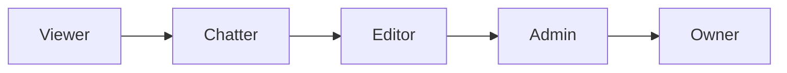
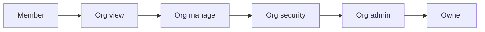
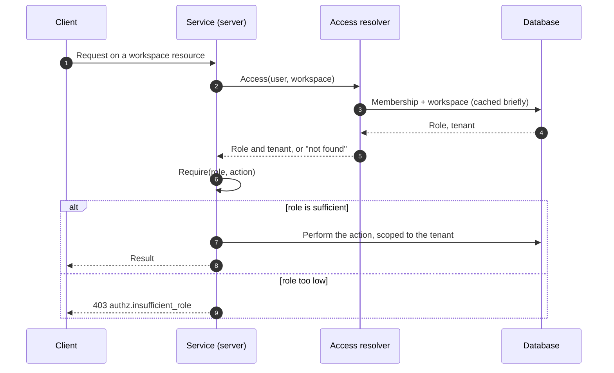

# RBAC System

Drumee uses **role-based access control**. A person holds a role, a role allows a set of actions, and the server checks the role before it touches any data. One role per person per workspace decides everything inside that workspace.

## Principles

1. **The server decides.** Every permission check runs on the server, in the code that performs the action. The interface only shows or hides controls according to what the server reports — hiding a button is never what protects data.
2. **One role per workspace.** A member has exactly one role in a workspace, and it applies to the whole workspace: every folder, file, conversation and task in it.
3. **Roles are a ladder.** Each role includes everything the role below it can do. A check is always "is this role at least *X*?".
4. **Unknown means refused.** An action that is not in the table requires the highest role. A person with no membership is told the resource does not exist.

## The three layers

| Layer | Answers | Where it applies |
| :---- | :---- | :---- |
| [Workspace role](#workspace-roles) | What may this person do **inside this workspace**? | Files, chat, tasks, meetings, members of one workspace |
| [Organization level](#organization-levels) | What may this person **administer in the organization**? | Members, teams, policies, audit log, billing |
| [Share link](#share-links) | What may **someone with this link** do? | One shared file, folder or task, for people outside the workspace |

The layers are independent. An organization administrator has no automatic access to the content of a workspace they are not a member of, and a share link grants nothing in the workspace beyond the item it points at.

## Workspace roles

| Role | In one sentence |
| :---- | :---- |
| **Viewer** | Can browse and open content in the browser |
| **Chatter** | Can also download, take part in conversations and comment on tasks |
| **Editor** | Can also create and change content, share it, and start meetings |
| **Admin** | Can also invite people, manage members and change workspace settings |
| **Owner** | The one person who can transfer ownership or delete the workspace |

In the application the roles are labeled **View**, **Chat**, **Edit**, **Admin** and **Owner**.

Each workspace has exactly **one owner**. The owner cannot be removed, cannot be given another role, and cannot leave: ownership must be transferred first, after which the former owner becomes an Admin. The roles that can be assigned or offered in an invitation are Viewer, Chatter, Editor and Admin.

### Actions and the minimum role

The whole model is one table: each action names the lowest role allowed to perform it.

| Action | Minimum role | Covers |
| :---- | :---- | :---- |
| `view` | Viewer | Browse, open and search |
| `download` | Chatter | Download originals, copy |
| `chat` | Chatter | Read and send messages, create topics |
| `task_comment` | Chatter | Comment on, reply to and react on tasks |
| `write` | Editor | Upload, create, rename, move, trash, lock |
| `share_link` | Editor | Create a share link |
| `task_write` | Editor | Create, edit and delete tasks, columns, sprints, labels |
| `meet_start` | Editor | Start or schedule a meeting, admit people from the lobby |
| `invite` | Admin | Invite people to the workspace |
| `manage_members` | Admin | Change roles, remove members |
| `manage_workspace` | Admin | Rename the workspace, change its settings, manage chat topics |
| `transfer_owner` | Owner | Hand the workspace to another member |
| `delete_workspace` | Owner | Move the workspace to the trash |
| `leave` | Viewer | Leave the workspace (the owner cannot) |

### What each role can do

| Capability | Viewer | Chatter | Editor | Admin | Owner |
| :---- | :----: | :----: | :----: | :----: | :----: |
| Browse, open, search | ✓ | ✓ | ✓ | ✓ | ✓ |
| Join a meeting in progress | ✓ | ✓ | ✓ | ✓ | ✓ |
| Download and copy files | – | ✓ | ✓ | ✓ | ✓ |
| Read and send chat messages | – | ✓ | ✓ | ✓ | ✓ |
| Attach files to messages and tasks | – | ✓ | ✓ | ✓ | ✓ |
| Comment on tasks | – | ✓ | ✓ | ✓ | ✓ |
| Upload, create, rename, move, trash files | – | – | ✓ | ✓ | ✓ |
| Edit documents in the browser | – | – | ✓ | ✓ | ✓ |
| Create share links | – | – | ✓ | ✓ | ✓ |
| Create and edit tasks | – | – | ✓ | ✓ | ✓ |
| Start or schedule meetings | – | – | ✓ | ✓ | ✓ |
| Invite people, manage members and roles | – | – | – | ✓ | ✓ |
| Workspace settings | – | – | – | ✓ | ✓ |
| See the whole trash, purge anything | – | – | – | ✓ | ✓ |
| Leave the workspace | ✓ | ✓ | ✓ | ✓ | – |
| Transfer ownership, delete the workspace | – | – | – | – | ✓ |

A few rules refine the table:

- **Viewing is not downloading.** A Viewer can read a PDF, play a video or look at an image in the browser, but cannot download the original file. This limits casual copying; it is not copy protection.
- **Authorship still matters.** Only the author can delete a chat message for everyone or edit a task comment — an Admin cannot do it for them. Below Admin, a person sees in the trash, and can restore or purge, only what they own or trashed themselves.
- **Locks.** An Editor can lock a file. Only the person who locked it, or an Admin, can unlock it.
- **Meeting moderation** belongs to the host, to the organizer of a scheduled meeting, and to Admins.
- **Members cannot change themselves.** An Admin cannot change their own role or the owner's.

### Workspace kinds

The kind of a workspace decides who can be a member at all.

| Kind | Members |
| :---- | :---- |
| **Personal** | Its owner only |
| **Internal** | Members of the organization. Visibility is *everyone*, *selected teams* or *private* (added by hand) |
| **External** | Members of the organization **and** people outside it |

In an external workspace, a person from outside the organization is either a **guest** (Viewer or Chatter) or an **outside member** (Editor or Admin). The distinction matters for plan limits — see [Plan limits](#plan-limits). A guest is an ordinary member with a guest-level role, not a separate kind of account.

Share links exist only in external workspaces.

## Organization levels

An organization (a *tenant*) has its own, separate ladder. It governs administration, not content.

| Level | Adds |
| :---- | :---- |
| **Member** | Belongs to the organization; sees the directory as far as the organization's directory policy allows |
| **Org view** | Read-only administration: analytics, storage report, list of workspaces, pending invitations |
| **Org manage** | Invite members; create and manage teams; manage the members and visibility of any workspace of the organization |
| **Org security** | Directory policy, security policy (mandatory two-factor authentication), file-move policy, audit log |
| **Org admin** | Change members' levels, remove members, rename the organization, reclaim a workspace whose owner has left |
| **Owner** | Transfer the organization; manage billing and the plan |

In the application the levels are labeled **Member**, **Viewer**, **Manager**, **Security admin**, **Admin** and **Owner**.

Rules that keep the ladder safe:

- **No one promotes above themselves.** To change someone's level you must be an Org admin, be at least at the target's current level, and be at least at the level you are granting. The same applies to the level offered in an invitation.
- **No one changes themselves or the owner.**
- **Sensitive transfers need a second factor.** Transferring the organization requires a one-time code sent by email.
- **Billing belongs to the owner alone**, whatever levels other people hold.
- **Administration is not access.** An Org manage or Org admin can add and remove members of a workspace through the organization settings, but does not thereby read its files or conversations. Another person's Personal workspace is hidden even from organization administrators.

Which levels are available depends on the plan.

### Teams

A team is a named group of members of an organization, available on plans that include teams. Teams carry **no permissions of their own**: they are used to give a set of people automatic membership of the internal workspaces assigned to their team, with that workspace's default role. Managing teams requires Org manage, and a person below Org admin cannot use team changes to add themselves to a workspace or raise their own role.

## Share links

A share link gives people **outside the workspace** access to one file, one folder or one task.

| Permission | Allows |
| :---- | :---- |
| *view* | Always on: open the shared item in the browser |
| `download` | Download originals and the folder as a zip archive |
| `chat` | Read the conversation of the shared folder; posting requires a signed-in account |
| `edit` | Reserved for editing through a link; today it grants what `download` grants |

Permissions are fixed when the link is created. For a task link the ceiling is view and comment.

**Protection options**

- **Expiry** — the link stops working at a chosen time.
- **Secure mode** — the visitor must pass a gate: an email address (optionally restricted to a list of addresses or domains), a password, or both. Passwords are stored only as Argon2id hashes.
- **Attempt limits** — repeated wrong passwords are throttled per visitor, and a link under sustained guessing locks itself temporarily.
- **Revocation** — permanent. A revoked link cannot be reactivated.
- **Notification and access log** — the creator can be notified when the link is opened, and see who opened it.

**Requesting more.** A visitor who needs more than the link offers can request it. Someone who manages the link approves or denies the request; nobody decides their own request. An approval is attached to the **signed-in account or the visitor's session** — never to an email address typed at the gate, because that address is not verified.

**Effective permission of a visitor** = the link's permissions ∪ the approvals granted to that visitor, capped by what the kind of target allows.

**Who manages a link.** Editors see and manage the links they created; Admins see and manage all links of the workspace. An Editor who is demoted loses control of their links.

Every request made through a link is checked on the server against the link: the requested item must be inside the shared target, in the same workspace, and not a hidden or system item.

## How a request is authorized

1. **Authentication** identifies the caller from the session. This is the only step performed by middleware.
2. **Access resolution.** The service asks for the caller's role in the workspace that owns the resource. The answer also carries the **tenant** — the request never states which tenant it is acting in; the tenant is derived from the resource.
3. **Role check.** The service requires the minimum role for the action it is about to perform.
4. **Write guard.** For actions that add data, the service also checks that the tenant is not read-only (over its plan limits).
5. **Scoped data access.** Every database call is filtered by the tenant resolved in step 2.

For a resource addressed directly by its ID (a file, a task, a conversation), the server first finds the resource, then runs the same checks **in the workspace that resource belongs to**.

Organization requests work the same way with the organization ladder: the caller's level in the organization named by the request is loaded, then checked against the minimum level of the action.

### Caching

A resolved workspace role is cached for a few minutes. A role change, a removal or a departure invalidates it immediately, and the invalidation is designed so that a request already in flight cannot write a stale role back. Even on a cache hit the server re-checks that the person still belongs to the organization. Organization levels are not cached.

### Denial responses

| Situation | Response |
| :---- | :---- |
| Not signed in | `401 auth.unauthorized` |
| Not a member of the workspace, or the resource belongs elsewhere | `404 common.not_found` — existence is not revealed |
| Member, but the role is too low | `403 authz.insufficient_role`, with the action, the caller's role and the required role |
| Organization is read-only (over plan limits) | `402 billing.read_only` |
| The plan does not include the feature or the limit is reached | `402` with a specific code |
| Not a member of the organization | `404 org.none` |
| Organization level too low | `403 org.privilege` |
| Share link revoked, expired or locked | `410` |
| Share link gate not passed | `403 share.gate_required` |

The distinction between `404` and `403` is deliberate: a person outside a workspace cannot learn whether an ID exists; a member learns exactly which role they are missing.

## Tenant isolation

Authorization decides *what* a person may do; tenant isolation guarantees it can only ever be done to the right organization's data.

- Every document that belongs to a tenant carries a `tenant_id`.
- Every data-access function takes the tenant ID as an explicit argument and **must use it in the query itself**. A static check in the build enforces this for the whole codebase; code that does not filter by tenant does not pass.
- The tenant ID comes from the access resolution above, never from a value the client supplies.
- Isolation is covered by dedicated tests that attempt to read one tenant's data as a member of another.

See [Directory Schema](./06-directory-schema.md) for how tenants, members and workspaces are stored.

## Plan limits

Plan limits are enforced on the server in the same decision path as roles. A plan sets how many people can be members, how many workspaces of each kind an organization can have, how many guests an external workspace accepts, whether people from outside may hold the Editor or Admin role, and which organization levels and features — teams, move policies, the audit log — are available.

:::info[Pending]

The limits of each plan will be listed here once the plans are finalized.

:::

Two rules hold on every plan:

- An **outside member** — someone from outside the organization with the Editor or Admin role — needs explicit approval from the workspace owner or an Org admin.
- When an organization exceeds its plan it becomes **read-only**: adding data and people is paused, while reading, downloading, removing and changing settings keep working.

## How the interface learns permissions

There is no separate "capabilities" call. The server includes the caller's effective permissions in the ordinary responses:

- `my_role` on every workspace, and `my_level` on every organization;
- per-resource flags where a simple role is not enough, such as `can_edit` on a document or `can_start` and `can_join` on a meeting;
- on a share page, both the link's permissions and the visitor's effective permissions.

When a role changes, the server sends a realtime event (`membership.changed`, `membership.removed`, `share_link.revoked`, …) so that open screens update at once. The realtime channel applies the same rules: subscribing to a workspace or a conversation is checked against the same access resolver, open subscriptions are re-validated periodically and whenever membership changes, and a revoked session is disconnected.

## Apps

An installed app acts as a bot member of the workspaces it was added to. A request from an app passes **two** gates: first the app's scopes (`files:read`, `files:write`, `chat:read`, `chat:write`, `tasks:read`, `tasks:write`, `workspace:read`), which deny by default, then the same role checks as a person. Apps cannot reach direct conversations and are confined to the organization that installed them.

## Audit log

Permission-relevant changes are recorded per organization: members added, removed or changed, invitations, workspace ownership and settings, share links created and revoked, access requests approved or denied, organization levels, teams and policies, plan changes, and app installations. Each entry records who, what, the target, when, and the request that caused it. Entries are kept for one year.

Reading the audit log requires the Org security level, on a plan that includes the audit log.
