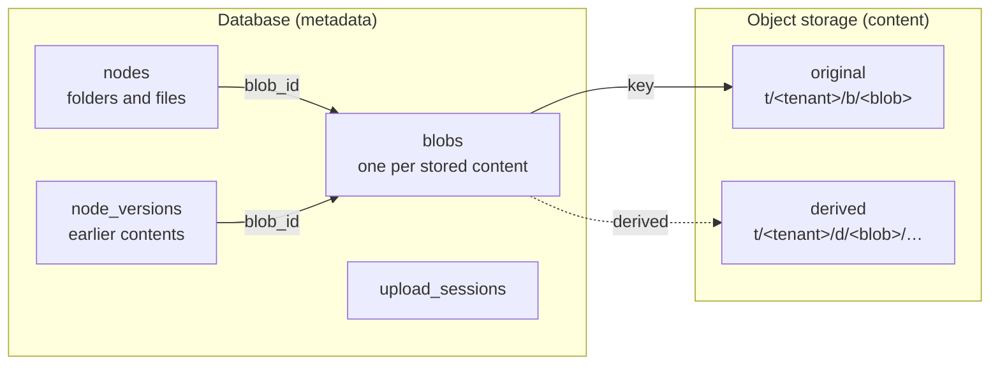
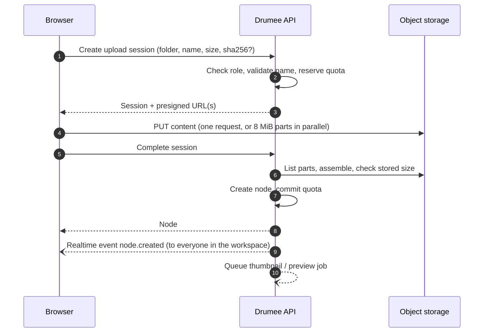

# File Storage

Drumee stores a file in two places. What the file **is** — its name, its place in the folder tree, who owns it, which version is current — is a document in the database. What the file **contains** is an object in S3-compatible object storage. The application server never keeps file bytes on its own disk, which is what lets any number of servers and workers run side by side.

## The two layers

| Layer | Holds | Technology |
| :---- | :---- | :---- |
| Metadata | The folder tree, names, owners, locks, trash state, versions, upload sessions | MongoDB |
| Content | Original bytes, thumbnails, previews, video renditions, document edit history | Any S3-compatible object store |

A **node** is a folder or a file. A **blob** is one stored content. A file node points to exactly one blob; several nodes may point to the same blob (copies, deduplicated uploads, versions), and the blob keeps a reference count.

## Nodes: the folder tree

Every workspace has one tree of nodes. The tree is stored as an adjacency list with a materialized ancestor path:

| Field | Meaning |
| :---- | :---- |
| `_id` | Node ID |
| `tenant_id`, `workspace_id` | The tenant and workspace that own the node |
| `parent_id` | The parent folder; empty for the workspace root |
| `path_ids` | IDs of all ancestors, root first |
| `kind` | `folder` or `file` |
| `name`, `name_lc` | Display name and its lowercase form, used for uniqueness |
| `ext`, `mime`, `type` | Extension, media type, and a class derived from the extension: `image`, `vector`, `video`, `audio`, `pdf`, `office`, `markdown`, `text`, `web`, `archive`, `other`, `folder` |
| `size`, `blob_id` | Size in bytes and the pointer to the content |
| `owner_id`, `modified_by` | Creator and last editor |
| `locked`, `locked_by` | File lock — a locked file cannot be written, renamed, moved or trashed |
| `hidden` | Set for names that start with a dot |
| `status`, `trashed` | `active` or `trashed`, with who trashed it, when, where it came from and when it will be purged |
| `derived` | Whether a thumbnail and previews exist |
| `created_at`, `updated_at` | Timestamps |

No path string is stored. A breadcrumb is resolved from `path_ids`; a subtree is "every node whose `path_ids` contains this folder". Moving a folder rewrites `path_ids` for its subtree, so a single operation is limited to 10,000 nodes.

### Names

- Names are trimmed and normalized to Unicode NFC. The characters `/`, `\` and `:` are replaced with `-`; control and bidirectional-control characters are removed.
- A name is unique within its folder, **case-insensitively**, among active nodes. Items in the trash do not block a name.
- When an upload, copy, move, restore or extraction would collide, the new item is numbered: `report (1).pdf`, `report (2).pdf`, and so on. A **rename** is never numbered silently — it fails with a `409 file.name_conflict`.
- Listings sort folders first, then by name with natural numeric order (`file2` before `file10`).

## Content: object storage

Drumee talks to object storage only through the S3 API. Any S3-compatible store works; the hosted service and the self-host stack use the same code path.

All tenants share one bucket, separated by key prefix:

| Object | Key |
| :---- | :---- |
| Original content | `t/<tenant_id>/b/<blob_id>` |
| Derived content (thumbnail, previews, video renditions) | `t/<tenant_id>/d/<blob_id>/<kind>` |
| Temporary objects (upload staging, account exports) | `t/<tenant_id>/tmp/…` |
| Document edit history | `t/<tenant_id>/office/<node_id>/…` |

The blob ID is random. Object keys carry no file name and no path, so renaming or moving a file never touches object storage.

### Deduplication

For files up to 32 MiB, the browser computes a SHA-256 of the content before uploading and announces it. If the same tenant already stores identical content, the upload is skipped and the new node references the existing blob.

Two rules keep this safe:

- **The server does not trust the announced hash.** A stored blob becomes a deduplication target only after the server has read the object back and verified its hash itself.
- **A hash never grants access.** Deduplication only applies when the uploader can already download a file that holds that content. Knowing a hash and a size is not enough to obtain someone else's file, and content is never deduplicated across tenants.

Copies inside a tenant share the blob as well. Shared bytes still count toward the storage quota once per file.

## Uploading

Bytes go **from the browser straight to object storage**. The API only authorizes the upload and records the result.

1. **Create a session.** The client sends the destination folder, name, size and optionally the SHA-256. The server checks that the caller may write there, validates the name, and **reserves** the size against the tenant's storage quota — an upload that would exceed the quota fails here, before any byte is sent.
2. **Choose a mode.**
   - *Deduplicated* — identical verified content already exists: nothing to upload.
   - *Single request* — files under 8 MiB are sent in one `PUT`.
   - *Multipart* — larger files are sent in 8 MiB parts, several in parallel. A file can have up to 10,000 parts (about 78 GiB).
3. **Upload.** Every presigned URL is signed for an exact content length; object storage rejects a body of any other size.
4. **Complete.** The server ignores any part list from the client: it lists the parts actually present in storage, assembles the object, and checks that the stored size equals the declared size. Only then does it create the node and convert the quota reservation into usage.

Completion is idempotent — repeating the call returns the same node — and two concurrent completions cannot both run.

### Resume

An upload session lives for 48 hours. If the tab is closed or the connection drops, the client asks the session which parts already arrived and sends only the missing ones. Individual requests are retried automatically on transient errors.

### Folders and batches

Dropping a folder creates its tree in one batch call, then opens upload sessions in batches of up to 100 files. Replacing an existing file (`on_conflict: replace`) keeps the previous content as a [version](#versions).

## Downloading and viewing

There are two read paths, chosen by purpose.

| Path | Used for | How |
| :---- | :---- | :---- |
| **Streamed by the server** | Downloads, zip archives, guest access | The server checks the permission on every request and streams the object, passing `Range` through so that partial requests work |
| **Presigned URL** | Viewers: thumbnails, image previews, video playback | A short-lived signed URL (15 minutes) pointing at object storage |

Whatever the path, user content is never served as something a browser could execute in the application's origin:

- The response type is derived from the file, not taken from what the uploader declared. Only a fixed list of types (common images, PDF, plain text, audio, video) may be displayed inline; everything else is sent as a download with `application/octet-stream`.
- Responses carry `X-Content-Type-Options: nosniff` and a sandboxing `Content-Security-Policy`.
- A presigned URL has the response type and disposition signed into it, so the link cannot be altered to render a file differently.

**Zip download** streams the selected files and folders as one archive directly from object storage, without building a temporary file on the server (up to 20,000 entries per archive).

Which role may view and which may download is defined in the [RBAC System](./02-rbac-system.md): viewing in the browser and downloading the original are separate permissions.

## Derived content

Thumbnails, previews and video renditions are produced by **background workers**, not by the request that uploaded the file. When a file is created the server queues a job; when the job finishes, clients receive a `node.derived_ready` event and swap the placeholder for the real preview.

| Source | Derived objects |
| :---- | :---- |
| Images | `thumb` (256 px), `preview-lq` (1280 px), `preview-hq` (2560 px, only when the original is larger) — JPEG, orientation applied |
| Video | A poster frame, a streaming rendition `stream` (H.264/AAC MP4, up to 1920 px), and a lighter `stream-lq` (up to 1280 px) when the source is larger. A source that is already a suitable MP4 is served as is |
| SVG | No raster copy; served with a restrictive content policy |
| PDF, text, audio | Rendered by the browser from the original |

Derived objects belong to the **blob**, so copies and deduplicated files share them, and they do not count toward the storage quota. Video jobs run on their own queue so that a long transcode never delays image thumbnails.

### Office documents

`docx`, `xlsx`, `xlsm` and `pptx` files open and are co-edited in the browser. Rendering and merging happen in the browser; the server's role is to put the editors' operations in one order, keep a durable log of them, and relay presence. Periodically an editor saves a snapshot of the whole document, which becomes a new [version](#versions) of the file. The operation log between snapshots gives the document a fine-grained edit history.

Other Office formats are stored and can be downloaded, but are not edited in the browser.

## Versions

Every write that replaces a file's content keeps the previous content as a version: replacing by upload, saving from an editor, rotating an image, restoring an older version.

- A file keeps up to 200 versions; beyond that the oldest is dropped.
- How far back history goes depends on the plan (see [Quota](#quota)). Older versions are pruned by a background job.
- Restoring a version makes the old content current again — and the content it replaces becomes a version in turn, so a restore can itself be undone.
- Versions count toward the storage quota.
- Editors detect conflicting saves: a save based on outdated content is rejected with `409 file.version_conflict` instead of overwriting someone else's work.

## Tree operations

| Operation | Behavior |
| :---- | :---- |
| **Move** within a workspace | Re-parents the node; collisions are numbered |
| **Move** to another workspace | Requires write access on both sides and is subject to the organization's move policy. Chat threads and share links stay with the source workspace |
| **Copy** | New nodes that reference the same blobs; folders are copied recursively. The copy counts toward the quota |
| **Rename** | Fails on a name collision |
| **Extract** a `.zip` | Runs as a background job with progress events, into a new folder named after the archive. Entries with path traversal (`..`, absolute paths) and symbolic links are skipped; encrypted archives are refused |
| **Batch** | Trash, move, copy, restore or purge up to 500 items in one call, with a result per item |

A locked file blocks any operation on it and on a folder that contains it.

## Trash and deletion

Deleting is always a two-step process.

1. **Trash.** The node and everything under it are marked `trashed`. They disappear from listings, cannot be reached by ID, and are kept for **30 days**. Trashed items still count toward the quota.
2. **Purge.** After 30 days a background job removes the nodes — or an administrator, or the owner of the item, purges earlier. Purging releases the versions and the edit history, and returns the bytes to the quota.

Restoring puts an item back in its original folder, or at the workspace root if that folder no longer exists.

Purging a node only **decrements the blob's reference count**. The object itself is deleted by a garbage-collection pass once nothing references it and a 24-hour safety delay has passed; the pass removes the original together with every derived object. Deleting a workspace follows the same pattern: 30 days in the trash, then its whole tree is purged.

## Quota

Storage usage is tracked per tenant as two counters: bytes **used** and bytes **reserved** by uploads in progress. An upload reserves its size when the session is created and commits it on completion; a failed or abandoned upload gives the reservation back. A periodic job reconciles the counters with the database.

What counts: every file (active or in the trash) and every stored version. What does not count: thumbnails, previews, video renditions, document edit logs and avatars.

The storage allowance and the length of version history depend on the plan.

:::info[Pending]

The limits of each plan will be listed here once the plans are finalized.

:::

When a tenant goes over its limit it becomes **read-only** for a grace period, then locked for writes until space is freed or the plan is changed. Reading and downloading keep working.

## Sharing

A share link points at one file or folder of a workspace and carries its own permissions (view, download, chat, edit), with optional password, expiry and email restriction. A guest who opens a link can reach only the nodes **inside the shared item** — never hidden files or the workspace's system folders — and every guest request is checked against the link on the server. Guest responses use the same safe-serving rules as member downloads.

See [RBAC System — Share links](./02-rbac-system.md#share-links) for how link permissions combine with roles.

## Import

**Google Drive import** runs as a background job: the server reads the selected files from Google and writes them directly to object storage, with progress events to the user. Google Docs, Sheets and Slides are converted to `docx`, `xlsx` and `pptx`. A file whose name already exists in the destination folder is skipped — an import never overwrites.

## Realtime events

Every change to the tree is published to the members of the workspace (and to the guests of a link that contains the node):

`node.created` · `node.updated` · `node.renamed` · `node.moved` · `node.trashed` · `node.restored` · `node.deleted` · `node.derived_ready`

Long-running jobs (extract, import) report to the user who started them with `job.progress`, `job.done`, `job.failed` and `job.cancelled`. How events travel is described in the [Request Pipeline](./04-request-pipeline.md#realtime).

## Integrity and encryption

- Uploads are verified by **size**: the signed content length on each request, the storage's own part checks, and the final stored size against the declared size.
- Content hashes (SHA-256) are used for deduplication and are verified by the server before they are relied on.
- File content is protected in transit by TLS. Encryption at rest and end-to-end encryption are covered in [Data Storage & Encryption](./05-data-storage-encryption.md).
