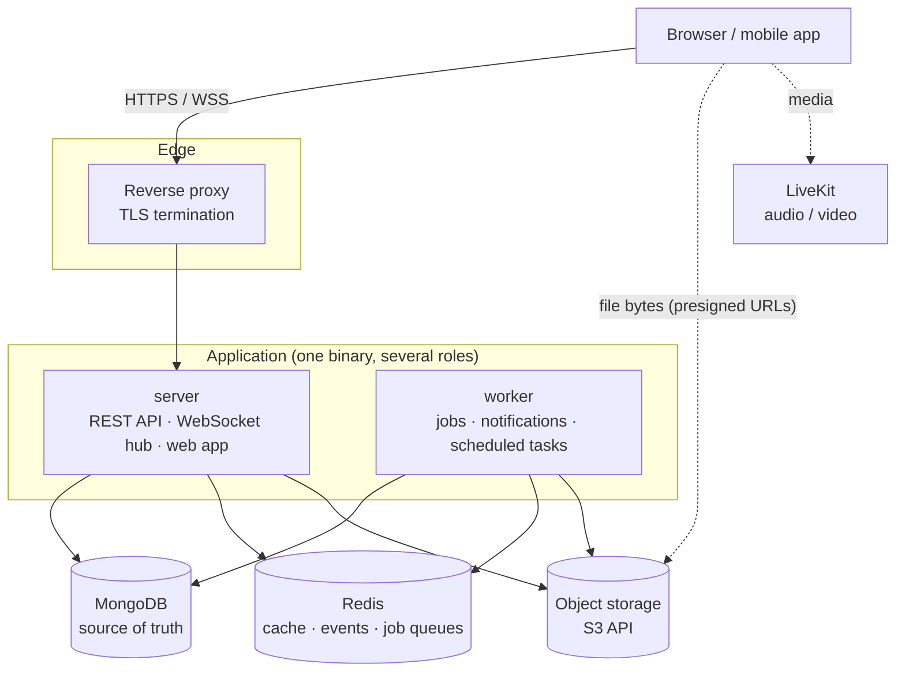
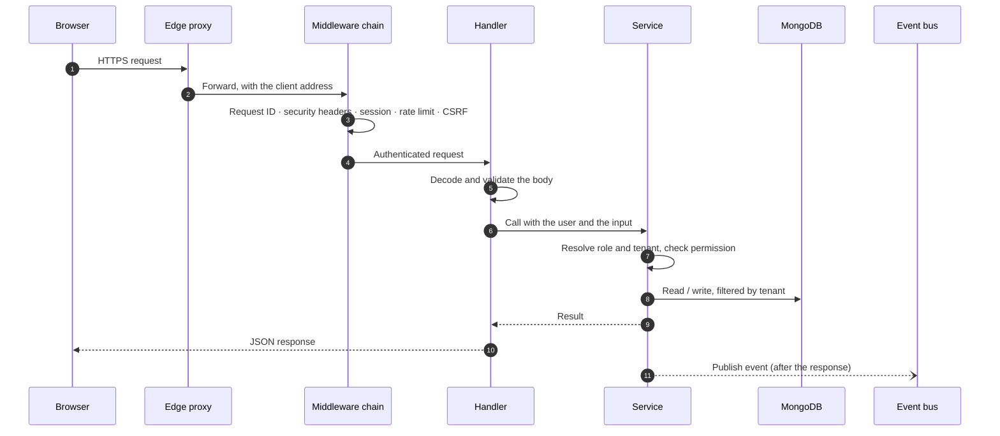
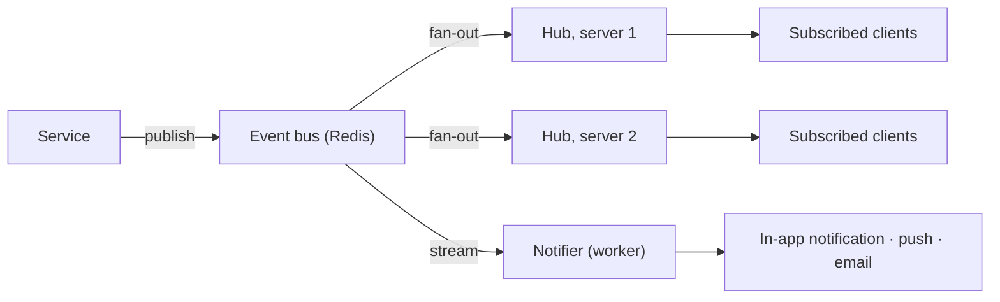

# Request Pipeline

This page follows a request through Drumee: from the browser to the database and back, and then on to the other people who need to see the change.

## The moving parts



Drumee is a **modular monolith**: one binary that runs as `server`, as `worker`, or as a one-shot `migrate`. The server handles requests; the worker does everything that should not make a request wait. Both are stateless between requests — durable state lives in MongoDB and object storage, shared short-lived state in Redis — so several servers and workers can run side by side.

| Path at the edge | Goes to |
| :---- | :---- |
| `/api/v1/*` | The REST API |
| `/ws`, `/ws/*` | The WebSocket hub |
| Object storage URLs | Object storage, directly |
| Everything else | The web application (a single-page app served by the same server) |

## Life of an API request



### 1. The edge

A reverse proxy terminates TLS, compresses responses, adds HSTS, and forwards to the server. It also sets the client address, which the server accepts only from proxies it has been configured to trust — so a client cannot forge its own address to dodge rate limits.

### 2. The middleware chain

Every request passes the same chain, in this order:

| # | Step | What it does |
| :-: | :---- | :---- |
| 1 | **Request ID** | Accepts or generates an ID, returns it in `X-Request-Id`, and attaches it to every log line and error |
| 2 | **Security headers** | `nosniff`, framing and referrer policies, a baseline Content-Security-Policy, a Permissions-Policy |
| 3 | **Version header** | Announces the server build, so an open tab can detect that it is outdated |
| 4 | **Recover** | Turns an unexpected failure into a clean `500` instead of a dropped connection |
| 5 | **Logger** | One structured line per request |
| 6 | **CORS** | An allow-list of the application's own origins — nothing else |
| 7 | **App tokens** | Authenticates requests made by installed apps and checks them against the app's scopes |
| 8 | **Session** | Identifies the user from the session cookie or bearer token |
| 9 | **Rate limit** | A per-user (or per-address, when anonymous) request budget |
| 10 | **CSRF** | Rejects state-changing requests that do not come from the application |
| 11 | **Require** | On private routes, refuses a request without an authenticated user (`401`) |

Authentication happens here. **Authorization does not**: it is the service's job (step 4 below), next to the code that performs the action.

### 3. Session authentication

Sessions are **opaque and stored on the server** — not self-contained tokens.

- At sign-in the server generates a random 256-bit token. The browser receives it in a cookie; the server stores only its SHA-256 hash, so a copy of the database contains no usable session.
- The cookie is `HttpOnly`, `Secure`, `SameSite=Lax` and uses the `__Host-` prefix, which binds it to the exact host and prevents a sibling subdomain from planting one. Mobile and API clients may carry the token in an `Authorization: Bearer` header instead. The token is never accepted from a URL.
- Every request looks the session up, checks that it is neither revoked nor expired and that the account is active. A session expires after 30 days without use and after 90 days in any case.
- Because sessions live on the server, **revocation is immediate**: signing out, removing a device, or changing a password ends the affected sessions at once and disconnects their realtime connections.

**Sign-in** verifies the password with Argon2id, limits attempts per account and per address, and takes the same time whether or not the email exists. If two-factor authentication is enabled — or required by the organization — the password step returns a short-lived challenge instead of a session, and the session is opened only after a valid authenticator code, emailed code or recovery code. **Sign-in with Google or Apple** follows the standard authorization-code flow, bound to the browser that started it, and ends in the same session.

**CSRF** is prevented without tokens: every state-changing request must carry a custom header that a browser will not let another site send without a CORS preflight — and the preflight is refused for any origin not on the allow-list. `SameSite=Lax` on the cookie is a second layer.

### 4. Handler → service → repository

Each domain (files, chat, tasks, …) is a package with the same three layers.

| Layer | Responsibility | Knows about |
| :---- | :---- | :---- |
| **Handler** | Decode the request, call the service, encode the response | HTTP |
| **Service** | Permission check, business rules, events | The domain |
| **Repository** | Queries | The database, and always the tenant |

**Input.** JSON bodies are limited in size, unknown fields are rejected, and declared constraints are validated before the service is called.

**Authorization and tenant.** The service resolves the caller's role in the workspace that owns the resource, and with it the tenant. The request never names its tenant; it is derived from the resource and then passed explicitly to every query. See [RBAC System](./02-rbac-system.md#how-a-request-is-authorized).

### 5. The response

Errors have one shape everywhere:

```json
{
  "error": {
    "code": "authz.insufficient_role",
    "message": "…",
    "params": { "action": "write", "role": "View", "required": "Edit" },
    "request_id": "01JD…"
  }
}
```

`code` is stable and machine-readable (`<domain>.<reason>`); clients translate it into the user's language, using `params`. `message` is for developers. `request_id` ties a report from a user to the server's logs. Internal causes are logged, never returned.

| Status | Meaning |
| :-: | :---- |
| `400` | Malformed request (`common.bad_json`, `common.bad_cursor`) |
| `401` | Not signed in |
| `402` | A plan limit stands in the way |
| `403` | Signed in, but not allowed |
| `404` | Does not exist — or not visible to the caller |
| `409` | Conflict with the current state (name taken, stale version) |
| `422` | Validation failed; `params.fields` names each field |
| `429` | Rate limited |

### API conventions

- **Versioned REST** under `/api/v1`, described by an OpenAPI contract from which the web client's types are generated.
- **Lists** return `{ "items": […], "next_cursor": "…" }`. The cursor is opaque; pass it back to get the next page.
- **Safe retries.** Creating a message or a task carries a client-generated `client_id`: sending the same request twice returns the first result instead of creating a duplicate. Completing an upload is idempotent in the same way.
- **Every failed action reports an error** — the client restores the previous state rather than leaving an optimistic change on screen.

## After the write: events {#realtime}

A change is not finished when the response is sent: other people looking at the same workspace need to see it.



Services publish an **event** for every change. An event has a fixed envelope:

| Field | Meaning |
| :---- | :---- |
| `id` | Unique, time-ordered; also the position used for replay |
| `type` | `<domain>.<name>`, for example `node.created`, `message.new`, `task.updated` |
| `room` | Who should receive it: `user:<id>`, `ws:<workspace>`, `conv:<conversation>`, `tenant:<id>`, `link:<code>` |
| `tenant_id`, `actor_id` | The tenant and the person behind the change |
| `client_id` | The browser tab that made the request |
| `ts`, `data` | Time and payload |

Publishing does three things at once: it fans the event out to the WebSocket hub of every server, appends it to a short replay buffer for its room, and appends it to a durable stream that background consumers read. Follow-up work runs after the response has been sent, so the caller never waits for it.

The originating tab recognizes its own `client_id` and ignores the echo — it already shows the change.

### The WebSocket connection

1. **Handshake.** The connection is authenticated with the same session as the API and accepted only from the application's own origins.
2. **Subscribe.** The client asks for rooms. **Each room is checked** with the same access rules as the API: a workspace room requires membership, a conversation room requires access to the conversation, a user room is the caller's own. Anything else is denied.
3. **Receive.** Events arrive as they are published.
4. **Stay valid.** Subscriptions are re-checked periodically and whenever membership changes. A lost permission drops the room; a revoked session closes the connection.
5. **Reconnect.** The client reconnects with back-off, states the last event it saw, and receives what it missed. The replay window is five minutes; beyond that, or if too much was missed, the server says so and the client reloads its data instead.

A new member never receives, by replay, events from before they joined.

### Notifications

A worker consumes the event streams and decides who should be notified — the assignee of a task, the people mentioned in a message — never the person who made the change. A notification is stored, pushed to the recipient's own room, and may go out as a mobile push or an email. Delivery to consumers is *at least once*: a consumer that fails keeps its event and retries.

## Background jobs

Work that is slow, or that must survive a restart, is queued.

| Queue | Work |
| :---- | :---- |
| `media` | Image thumbnails and previews |
| `media-video` | Video poster frames and streaming renditions — on its own queue, so a long transcode never delays thumbnails |
| `archive` | Extracting zip archives |
| `export` | Building an account's data export |
| `gdrive` | Importing from Google Drive |
| `mail`, `push` | Email and mobile push delivery |

A failed job is retried a limited number of times, then moved to a dead-letter queue. A job whose worker died is picked up by another worker. Running jobs report progress to the user through the realtime channel.

**Scheduled tasks** — purging expired trash, pruning old versions, garbage-collecting unreferenced content, reconciling storage usage, meeting reminders — run on a timer under a distributed lock, so exactly one worker runs each of them however many are deployed.

## File transfer

File bytes take a different road from everything else: **uploads go from the browser straight to object storage** using presigned URLs. The API authorizes the upload, and afterwards verifies and records it, but never relays the content. Previews and video playback are read from object storage the same way; downloads of originals are streamed by the server so that the permission is checked on every request.

→ [File Storage](./03-file-storage.md#uploading)

## Scaling out

| Concern | How it is shared |
| :---- | :---- |
| Sessions, data | MongoDB — any server can serve any request |
| Role cache, rate limits, short-lived challenges | Redis |
| Realtime | Every server has a hub; Redis fans each event out to all of them, and the replay buffer is shared, so a client can reconnect to any server |
| Jobs and event consumers | Redis consumer groups — each item is handled by one worker |
| Scheduled tasks | A distributed lock elects one runner |
| File content | Object storage — no server holds files on local disk |

The only state a server keeps in memory is its own open WebSocket connections.

## Two traces

### Creating a task

1. The browser sends `POST /api/v1/workspaces/{id}/tasks` with a `client_id`.
2. The middleware chain identifies the user and applies the rate limit and CSRF check.
3. The handler validates the body and calls the task service.
4. The service resolves the caller's role in the workspace and requires `task_write` (Editor). The tenant comes from the workspace.
5. It validates the references — assignees must be members, attachments must be in the same workspace — and inserts the task into the tenant's data.
6. The response `201` returns the task.
7. After the response, the service records the activity and publishes `task.created` to the workspace room.
8. Every hub delivers the event to the tabs subscribed to that workspace. The creating tab ignores its own echo.
9. A worker reads the event and notifies the assignees and the people mentioned.

### Sending a chat message

1. The browser shows the message immediately and sends `POST /api/v1/conversations/{id}/messages` with a `client_id`.
2. The chat service finds the conversation and checks access: a participant, for a direct conversation; a member with at least the Chatter role, for a workspace conversation.
3. It validates attachments and mentions, and stores the message. If the same `client_id` arrives again — a retry after a network error — the first message is returned and nothing is published twice.
4. `message.new` is published to the conversation room; subscribers, each of whom passed the access check when subscribing, receive it.
5. Inbox counters, conversation previews and notifications follow, after the response.
