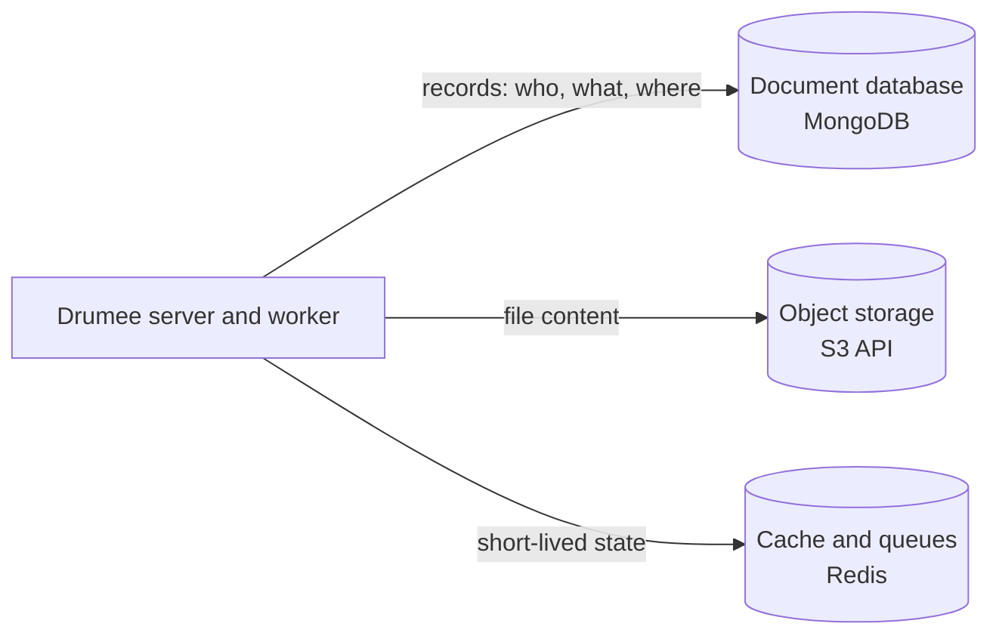

# Data Storage & Encryption

This page describes where Drumee keeps data, how the data of one organization is kept apart from another's, and how encryption protects it at every layer.

## Encryption at a glance

| Layer | Protection | Status |
| :---- | :---- | :---- |
| Data in transit | TLS for the API, the web app, realtime and file transfer; encrypted media for meetings | ✅ In place |
| Passwords, sessions, codes | One-way hashes (Argon2id, SHA-256, HMAC) — never stored in readable form | ✅ In place |
| Stored secrets | AES-256-GCM with per-purpose keys | ✅ In place |
| Data at rest | Encryption of database volumes and object storage, at the storage layer | ✅ Storage layer |
| Content, end to end | Keys on members' devices; the server holds ciphertext only | 🔄 In development |

Each row is detailed below.

## Three stores

| Store | Holds | Durable? |
| :---- | :---- | :---- |
| **Document database** (MongoDB, replica set) | Accounts, organizations, memberships, workspaces, the file tree, messages, tasks, meetings, audit log | Yes — the source of truth |
| **Object storage** (any S3-compatible store) | File content, thumbnails and previews, video renditions, document edit history, exports | Yes |
| **Cache and queues** (Redis) | Role cache, rate-limit counters, sign-in challenges, realtime fan-out and replay, job queues | No — everything here can be rebuilt or expires |

The application servers themselves hold **no data**: no files on local disk, no sessions in memory. That is what allows the platform to run on cloud infrastructure, add servers under load, and replace one without losing anything.

File content never passes through the database, and file names never appear in object storage: an object is addressed by a random identifier under its tenant's prefix. → [File Storage](./03-file-storage.md)

## Separating tenants

A **tenant** is the unit of ownership: every person has a personal tenant, and an organization is a tenant shared by its members.

| Database | Contents |
| :---- | :---- |
| **Global** | The directory: accounts, sessions, tenants, memberships, invitations, direct conversations, notifications, billing |
| **Tenant data** | Everything that belongs to one tenant: workspaces, files, workspace chat, tasks, meetings, share links, audit log |

Tenant data is kept in shared collections in which **every document carries its `tenant_id`**, and the storage layer can also place a tenant in a database of its own. Either way the rule is the same and it is enforced mechanically:

- Every data-access function takes the tenant as an explicit argument and must use it in the query. A static check that runs on every build rejects code that does not.
- The tenant is derived on the server from the resource being accessed — never taken from the client.
- Object storage keys begin with the tenant: `t/<tenant_id>/…`.
- Automated tests attempt cross-tenant reads and must fail.

The collections of the global database are documented field by field in [Directory Schema](./06-directory-schema.md).

## Encryption in transit

| Connection | Protection |
| :---- | :---- |
| Browser or app ↔ Drumee (API, web app) | TLS, with HSTS |
| Realtime (WebSocket) | TLS (`wss://`) |
| Browser ↔ object storage (uploads, previews) | TLS; each URL is presigned, short-lived, and signed for one object |
| Meetings and calls | WebRTC media is encrypted in transit (DTLS-SRTP) between each participant and the media server; signalling runs over TLS |
| Server ↔ database, cache, bundled object storage | Authenticated connections on a private network that is not reachable from outside. Transport encryption on these internal links depends on the deployment; it is not imposed by the application |
| Server ↔ external S3 storage | TLS, when the storage endpoint is HTTPS |

## Encryption and hashing at rest

Drumee distinguishes three kinds of sensitive values, and treats each differently.

### Values nobody needs to read back — hashed

| Value | Stored as |
| :---- | :---- |
| Account passwords | **Argon2id** (64 MiB memory, per-password random salt) |
| Share-link and meeting-link passwords | Argon2id |
| Session tokens | SHA-256 of a random 256-bit token — the token itself is never stored |
| Email verification, password-reset and invitation codes | SHA-256 |
| One-time codes sent by email | Keyed digest (HMAC-SHA256), bound to the account and the action |
| Two-factor recovery codes | Keyed digest, bound to the account |
| App client secrets and tokens | SHA-256 |

A copy of the database therefore contains no password, no usable session, and no usable code.

### Secrets the server must read back — encrypted

Some secrets have to be used by the server later, so they cannot be hashed. They are sealed with **AES-256-GCM** before they are written:

- authenticator-app (TOTP) seeds;
- refresh tokens of linked sign-in providers;
- tokens of a linked Google Drive account;
- signing secrets of app webhooks.

How sealing works:

- One server secret, held outside the database, is the root. A separate key is derived from it for each purpose with **HKDF-SHA256**, so the key that protects authenticator seeds is not the key that protects Drive tokens.
- Each value is encrypted with a fresh random nonce and **bound to the record it belongs to**: a sealed value copied onto another account does not decrypt there.
- The server refuses to start in production without this secret, or with a placeholder value.

Whoever obtains the database or a backup — without the server secret — cannot recover these values.

### Content — encrypted at the storage layer, end to end next

Files, messages, tasks and documents are the data Drumee exists to serve, search, preview and co-edit.

- **In transit**, content always travels encrypted (see above).
- **At rest**, content is encrypted at the storage layer: database volumes and object-storage buckets are encrypted by the infrastructure the platform runs on (volume encryption, bucket-level server-side encryption).
- **In the application**, every read is authorized on the server and filtered by tenant before any content is returned.

The next layer — encrypting content with keys that only its members hold — is end-to-end encryption.

## End-to-end encryption

:::info[In development]

End-to-end encryption is in development and will be released in stages; it is not available yet. This section describes the model; the full specification will replace it as each stage ships.

:::

With end-to-end encryption, the content of a protected space can be read only on its members' devices: keys are generated and kept on the client, and the server, the database, object storage and backups hold ciphertext only.

It is adopted by degrees rather than all at once:

| Level | Scope |
| :---- | :---- |
| Standard | Transport encryption, access control, storage-level encryption at rest |
| Protected space | One conversation, one folder, one document or one meeting is end-to-end encrypted |
| Protected workspace | Everything in a workspace |
| Organization policy | An organization requires protection for its workspaces, with managed key recovery |

End-to-end encryption changes what a server can do for you, and the design is explicit about it: the server cannot search, preview, convert or deduplicate what it cannot read, and losing every device together with the recovery key means losing the data. Metadata — who is a member, when something changed, how large it is — remains visible to the server.

## Retention and deletion

Nothing is destroyed by a single click, and nothing is kept forever by accident.

| Data | Lifecycle |
| :---- | :---- |
| Files and folders | Trash for 30 days, then purged. Content is removed from object storage once nothing references it |
| Workspaces | Trash for 30 days, then purged with all their content |
| File versions | Kept according to the plan's history length, up to 200 per file |
| Accounts | On deletion the account is closed at once and its personal data is removed after 30 days |
| Sessions, one-time codes, email tokens | Expire automatically |
| Notifications | 90 days |
| Audit log | 1 year |
| Data exports | The archive is kept for 7 days |

**Export.** A person can export their data as an archive at any time. Because an export is everything at once, downloading it requires a recent re-authentication.

**Account deletion** requires the password or a one-time code. Workspaces the person owns in an organization are handed over rather than destroyed, and the email address is released so that it can be used again.

## Summary

| Question | Answer |
| :---- | :---- |
| Is traffic encrypted? | Yes — TLS for the API, the web app, realtime and file transfer; encrypted media for meetings |
| Are passwords stored? | Only as Argon2id hashes |
| Can a database leak expose sessions or codes? | No — only hashes and keyed digests are stored |
| Are stored secrets encrypted? | Yes — AES-256-GCM, per-purpose keys, bound to their record |
| Is file and message content encrypted at rest? | Yes — at the storage layer (encrypted volumes and buckets) |
| Is content end-to-end encrypted? | In development — it will be released in stages |
| Can one organization read another's data? | No — every query is tenant-scoped, enforced by a build-time check and by tests |
