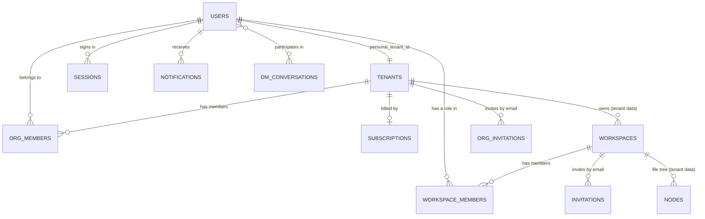
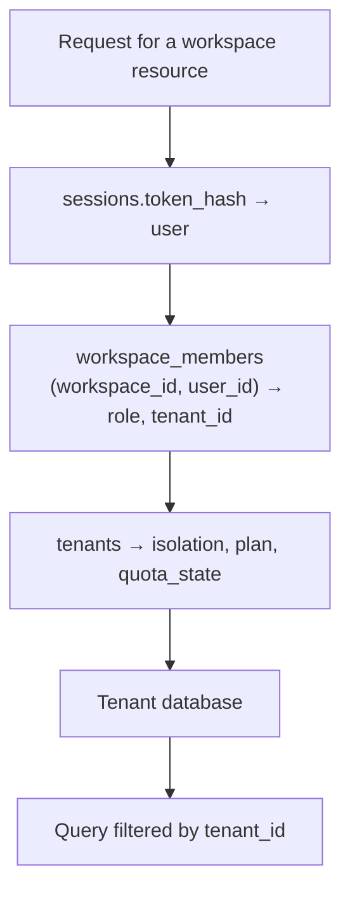
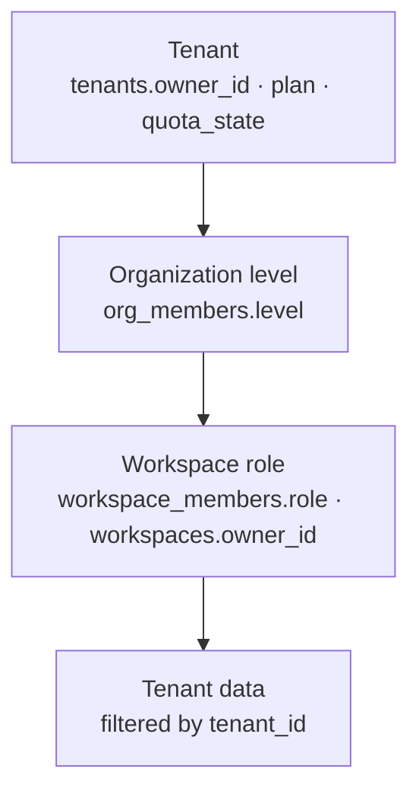

# Directory Schema — the Global Database

Drumee keeps two kinds of data. **Tenant data** belongs to one organization: its workspaces, files, conversations and tasks. The **directory** belongs to no single organization: it says who exists, which organizations exist, and who belongs to what. The directory lives in the **global database**, and every request starts there.

This page is the reference for the global database.

## The central idea

Three questions are answered by the directory, in this order, for every request:

| Question | Answered by |
| :---- | :---- |
| Who is calling? | `sessions` → `users` |
| What do they belong to? | `org_members` (organizations) and `workspace_members` (workspaces) |
| Where is the data? | `tenants` — which names the database that holds the tenant's data |

Memberships are global on purpose. A person can belong to several organizations, and can be a member of a workspace owned by an organization they are **not** part of (a guest or an outside member). Neither fact could be recorded inside one tenant's data.

## Entity relationships

- Every user has exactly one **personal tenant**, created at sign-up together with a personal workspace.
- A tenant is `personal` or `org`. Subscribing to a team plan turns the personal tenant into an organization **in place** — the data does not move.
- An organization's role ladder is stored on `org_members.level`; a workspace's on `workspace_members.role`. They are independent. → [RBAC System](./02-rbac-system.md)

## Databases

| Database | Holds | Selected by |
| :---- | :---- | :---- |
| **Global** | The directory and everything that spans tenants | Always the same |
| **Tenant pool** | The data of all tenants that share a database; every document carries `tenant_id` | `tenants.isolation = "pool"` |
| **Dedicated** | The data of one tenant alone | `tenants.isolation = "dedicated"`, named by `tenants.db_name` |

The storage layer resolves a tenant ID to its database. Code never chooses a database itself, and filters by `tenant_id` in every query regardless of which database it lands in.

## How a request finds its data

No part of the chain depends on a value the client provides beyond the session and the resource ID: the tenant comes from the membership row, and the role with it.

## Conventions

| Convention | Rule |
| :---- | :---- |
| **IDs** | ULID: 26 characters, sortable by creation time. IDs identify; they are not secrets |
| **Secrets** | Random tokens (sessions, links, codes) are generated separately from IDs and stored only as hashes |
| **Timestamps** | UTC. `created_at` and `updated_at` on most documents |
| **Soft delete** | `deleted_at` marks a removed document; a purge date says when it is destroyed |
| **Expiry** | Short-lived documents carry `expires_at` and are removed automatically by a TTL index |
| **Email** | Stored in lower case |

---

## Identity

### `users` — accounts

| Field | Type | Meaning |
| :---- | :---- | :---- |
| `_id` | string | User ID |
| `email` | string | Lower case; unique |
| `email_verified` | bool | The address has been confirmed |
| `password_hash` | string | Argon2id hash; absent for accounts that only sign in with a provider |
| `oauth_only` | bool | Signed up with Google or Apple and never set a password |
| `first_name`, `last_name` | string | Display name |
| `username`, `username_lc` | string | Optional handle and its lower-case form |
| `bio`, `avatar_blob_id`, `language` | string | Profile |
| `personal_tenant_id` | string | The user's own tenant → `tenants._id` |
| `status` | string | `active` · `blocked` · `archived` · `pending_deletion` · `registration_incomplete` |
| `status_changed_at` | date | When `status` last changed |
| `delete_after` | date | When an account in `pending_deletion` is removed |
| `deleted_email` | string | The original address of a deleted account, after it has been released |
| `mfa` | object | Two-factor authentication — see below |
| `oauth` | array | Linked sign-in providers — see below |
| `credentials_changed_at`, `credentials_version` | date, int | Incremented when the password or the second factor changes; invalidates sign-in steps started before the change |
| `email_notifications` | bool | Email notification preference |
| `phone` | object | Optional phone number |
| `onboarding` | object | Product tours seen, survey state |
| `referral_code`, `referred_by` | string | Referral program |
| `last_seen_at` | date | Last activity |
| `app_id` | string | Set on the bot account of an installed app; such an account has no password and no session |
| `support_account` | bool | Marks the in-app support contact |
| `created_at`, `updated_at` | date | |

**`mfa`**

| Field | Meaning |
| :---- | :---- |
| `enabled` | Two-factor authentication is on |
| `enforced_by_org` | An organization the user belongs to requires it |
| `totp_secret` | Authenticator seed, encrypted (AES-256-GCM) |
| `totp_enabled_at` | When the authenticator was set up |
| `recovery_hashes` | Recovery codes, as keyed digests; a used code is removed |

**`oauth[]`**

| Field | Meaning |
| :---- | :---- |
| `provider` | `google` or `apple` |
| `subject` | The provider's identifier for the person |
| `email` | The address the provider reported |
| `linked_at` | When the link was made |
| `sign_in` | The link may be used to sign in |
| `refresh_token`, `client_id` | Provider token, encrypted, kept where the provider requires it for revocation |

**Indexes:** unique `email` · unique `referral_code` (when set) · unique `username_lc` (when set) · unique `(oauth.provider, oauth.subject)` (when set) · `(status, delete_after)`.

### `sessions` — signed-in devices

| Field | Type | Meaning |
| :---- | :---- | :---- |
| `_id` | string | Session ID |
| `user_id` | string | → `users._id` |
| `token_hash` | string | SHA-256 of the session token. The token itself is never stored |
| `device` | object | `name`, `os`, `browser`, `ua` — shown in the list of devices |
| `ip` | string | Address at sign-in |
| `current_tenant_id` | string | Reserved |
| `created_at`, `last_used_at` | date | |
| `expires_at` | date | Idle expiry, extended on use |
| `revoked_at`, `revoked_reason` | date, string | Set when the session is ended |
| `reauth_at` | date | Last re-authentication, required for sensitive actions |
| `push` | object | Mobile push registration |
| `cookie_v` | int | Cookie format version |

**Indexes:** unique `token_hash` · `(user_id, revoked_at)` · TTL on `expires_at` · unique `push.token` (when set).

### `email_tokens` — links sent by email

| Field | Meaning |
| :---- | :---- |
| `_id`, `user_id` | |
| `kind` | `verify` · `reset` · `email_change` · `email_undo` |
| `token_hash` | SHA-256 of the token in the link |
| `address` | The address concerned, for an email change |
| `data` | Kind-specific payload |
| `tries` | Submissions that reached the check, for reset links |
| `expires_at`, `used_at`, `created_at` | |

**Indexes:** unique `token_hash` · TTL on `expires_at` · `address` (when set).

### `otp_codes` — one-time codes

| Field | Meaning |
| :---- | :---- |
| `_id`, `user_id` | |
| `action` | What the code authorizes (sign-in, email change, data export, …). A code is valid for one action only |
| `code_hash` | Keyed digest of the six-digit code, bound to the user and the action |
| `attempts` | Wrong attempts so far |
| `expires_at`, `used_at`, `created_at` | |

**Indexes:** `(user_id, action, created_at)` · TTL on `expires_at`.

### `login_events` — sign-in history

| Field | Meaning |
| :---- | :---- |
| `_id`, `user_id`, `email` | |
| `ip`, `ua` | Address and client |
| `result` | `ok` · `bad_password` · `not_found` · `locked` · `blocked` · `mfa_pending` · `superseded` |
| `created_at` | |

**Indexes:** `(user_id, created_at)` · attempts on unknown addresses expire after 30 days.

---

## Tenants and organizations

### `tenants` — the unit of ownership

| Field | Type | Meaning |
| :---- | :---- | :---- |
| `_id` | string | Tenant ID — the value of `tenant_id` everywhere else |
| `kind` | string | `personal` or `org` |
| `name` | string | Organization name |
| `ident` | string | Unique short identifier (when set) |
| `owner_id` | string | → `users._id`. The owner is always at the top of the organization ladder |
| `isolation` | string | `pool` or `dedicated` |
| `db_name` | string | Database name, for a dedicated tenant |
| `plan` | object | The limits in force — see below |
| `usage` | object | `storage_bytes`, `seats_used` |
| `quota_state` | string | `normal` · `read_only` · `hard_locked` |
| `over_seats` | bool | More members than seats |
| `grace_until` | date | End of the grace period before a read-only tenant is locked |
| `directory` | object | `visibility` (`all` · `nobody`) and `info` (`all` · `name_only`): what plain members see of each other |
| `security` | object | `mfa_required_admins`, `mfa_required_all` |
| `files` | object | `cross_workspace_move`, `cross_org_move`: who may move content across workspaces and organizations |
| `trial` | object | `campaign`, `plan_code`, `ends_at`, `ended` |
| `flags` | object | Per-tenant feature switches |
| `created_at`, `updated_at`, `deleted_at` | date | |

**`plan`** — the limits in force, stored on the tenant itself.

| Field | Meaning |
| :---- | :---- |
| `code` | `free` · `team` · `business` · `self_hosted` |
| `storage_bytes` | Storage limit; `0` means unlimited |
| `seats` | Number of members |
| `max_internal`, `max_external` | Number of internal and external workspaces; `0` means unlimited |
| `ext_guests` | Guests allowed per external workspace |
| `ext_members` | Outside members: `0` none, `-1` allowed with approval |
| `meeting_max_min` | Maximum meeting length in minutes; `0` means unlimited |
| `version_history_days` | How long file versions are kept |
| `teams`, `move_policies`, `audit`, `api`, `sso` | Features included |
| `source` | Where the plan comes from: `stripe` · `trial` · `partner` · `manual` · `free` |

**Indexes:** unique `ident` (when set) · `owner_id` · `isolation`.

### `org_members` — who belongs to which organization

| Field | Type | Meaning |
| :---- | :---- | :---- |
| `tenant_id` | string | → `tenants._id` |
| `user_id` | string | → `users._id` |
| `level` | string | `member` · `org_view` · `org_manage` · `org_security` · `org_admin` · `owner` |
| `status` | string | `active` · `blocked` · `archived`. Only an active membership grants anything |
| `status_changed_at` | date | |
| `departments` | array | IDs of the teams the member belongs to |
| `invited_by` | string | → `users._id` |
| `created_by_org` | bool | The account was created by the organization |
| `created_at` | date | |

**Indexes:** unique `(tenant_id, user_id)` · `user_id` · `(tenant_id, status)`.

A person can have rows in several organizations. The owner of a tenant holds the `owner` level by virtue of `tenants.owner_id`, even without a row.

### `org_departures` — when a person left

One row per `(tenant_id, user_id)`, recording when the person last left the organization or was removed from it. The clean-up of what they held inside the organization relies on it: only someone who really was a member is swept, and only of what they held before that moment.

**Index:** unique `(tenant_id, user_id)`.

### `subscriptions` — billing state

One document per tenant, with `_id` equal to the tenant ID: a mirror of the payment provider's subscription.

| Field | Meaning |
| :---- | :---- |
| `_id` | Tenant ID |
| `user_id` | The buyer — the owner |
| `stripe_customer_id`, `stripe_subscription_id` | Provider references |
| `plan_code`, `cycle` | Plan and billing cycle (`month` · `year`) |
| `status` | `active` · `past_due` · `canceled_pending_end` · `unpaid` · `canceled` |
| `current_period_end`, `cancel_at_period_end` | |
| `pending_change` | A plan change scheduled for the end of the period |
| `past_due_since`, `last_event_at`, `reconciled_at`, `updated_at` | |

No card or bank data is stored by Drumee: payment details stay with the payment provider.

---

## Workspace membership

### `workspace_members` — who has which role in which workspace

| Field | Type | Meaning |
| :---- | :---- | :---- |
| `tenant_id` | string | The tenant that **owns the workspace** — not the member's own tenant |
| `workspace_id` | string | → `workspaces._id`, in that tenant's data |
| `user_id` | string | → `users._id` |
| `role` | string | `viewer` · `chatter` · `editor` · `admin` · `owner` |
| `added_by`, `added_at` | string, date | |
| `auto` | bool | Joined automatically through the workspace's visibility or a team, rather than by hand |
| `role_set` | bool | The role of an automatic member was changed by hand; a later change of the workspace's default role leaves it alone |
| `locked`, `unlocked_at` | bool, date | The row is kept but gives no access, because the tenant's plan no longer covers shared internal workspaces; access returns when the plan does |
| `chat_since` | date | When the member's role last rose to Chatter or above; realtime replay of the workspace's conversations starts there for them |
| `app` | bool | The member is the bot account of an installed app |

**Indexes:** unique `(tenant_id, workspace_id, user_id)` · `(user_id, tenant_id)` · `workspace_id`.

This collection is what makes external collaboration possible: the row sits in the directory, names the owning tenant, and so lets a person from anywhere hold a role in a workspace without belonging to its organization.

The **owner** of a workspace is defined by `workspaces.owner_id`; the owner also has a member row with the role `owner`. A member row alone never makes someone the owner.

### `workspace_role_caps`

One row per `(workspace_id, user_id)`: the role a person held by hand when their membership ended. It serves as a ceiling if their membership is later re-created automatically.

**Index:** unique `(workspace_id, user_id)`.

### `invitations` — invitations to a workspace

| Field | Meaning |
| :---- | :---- |
| `_id`, `tenant_id`, `workspace_id`, `workspace_name` | |
| `email` | The invited address. Only the account with this verified address can accept |
| `role` | The role offered: `viewer` · `chatter` · `editor` · `admin` |
| `status` | `pending` · `accepted` · `declined` · `cancelled` · `expired` |
| `inviter_id`, `inviter_name`, `message` | |
| `code_hash` | SHA-256 of the code in the invitation link |
| `invitee_user_id`, `answered_by`, `answered_at` | |
| `created_at`, `expires_at` | An invitation is valid for 7 days |

**Indexes:** unique `code_hash` · `(workspace_id, email, status)` · `(email, status)`.

An invitation is re-validated when it is accepted: the inviter must still be allowed to invite, and the plan must still have room.

### `org_invitations` — invitations to an organization

Same shape, with `tenant_id`, `tenant_name`, the organization `level` offered and optional `team_ids` in place of the workspace and role.

**Indexes:** unique `code_hash` · `(tenant_id, status)` · `(email, status)`.

---

## People and conversations across tenants

### `contacts`, `contact_requests`, `contact_blocks`

A personal address book. A contact belongs to its `owner_id` and may point at another account (`user_id`) or be a plain entry with `emails`, `phones`, `address`, `tags` and a `note`. Requests carry `from_user_id`, `to_user_id` or `to_email`, a `status` and an expiry. A block is a pair `(blocker_id, blocked_id)`.

**Indexes:** unique `(owner_id, user_id)` · unique `(blocker_id, blocked_id)`.

### `dm_conversations`, `dm_messages`, `dm_read_cursors`

Direct conversations between two people, who may belong to different organizations — which is why they live in the directory rather than in a tenant.

| Collection | Key fields |
| :---- | :---- |
| `dm_conversations` | `kind` (`direct` · `support`), `participants`, `pair_key` (unique per pair), `last_message`, `last_message_at` |
| `dm_messages` | `conversation_id`, `sender_id`, `client_id`, `content`, `attachments`, `mentions`, `reply_to`, `reactions`, `deleted_at`, `created_at` |
| `dm_read_cursors` | `(conversation_id, user_id)` → `last_read_message_id` |

`dm_messages` has a unique index on `(conversation_id, client_id)`: sending the same message twice stores it once.

Workspace conversations use the same document shapes but are stored with the tenant's data.

### `notifications`, `user_prefs`

| Collection | Key fields |
| :---- | :---- |
| `notifications` | `user_id`, `tenant_id` (the organization it comes from), `type`, `group`, `title_key` and `params` (translated on the client), `actor`, `target`, `count` (similar notifications are merged), `read_at`, `bookmarked_at`, `expires_at` |
| `user_prefs` | One document per user: pinned workspaces, muted items, seen markers |

Notifications expire after 90 days.

### `calls`

The log of direct audio and video calls: `caller_id`, `callee_id`, `kind`, `status`, `ended_reason`, `answered_at`, `ended_at`, `duration_ms`.

---

## Other global collections

| Collection | Purpose |
| :---- | :---- |
| `checkout_sessions`, `billing_customers`, `stripe_events`, `promo_codes`, `trial_claims`, `upgrade_hints` | Billing: checkouts in progress, provider customers, processed provider events (so that each is applied once), promotions and trials |
| `gdrive_links`, `gdrive_imports` | A user's linked Google Drive account (tokens encrypted) and the state of import jobs |
| `data_exports` | Account data exports; at most one active export per user |
| `transfer_requests` | Requests to move content across workspaces or organizations that need an approval |
| `content_reports` | Abuse reports; kept for one year |
| `apps`, `app_installations`, `app_user_grants`, `app_webhook_deliveries` | The app platform: registered apps, where they are installed, user authorizations, webhook delivery log |
| `metrics_events`, `surveys` | Onboarding metrics and survey answers |

---

## Tenant data

For completeness, the collections that hold a tenant's own data. Every document carries `tenant_id`, and indexes start with it.

| Collection | Holds |
| :---- | :---- |
| `workspaces` | `name`, `kind` (`personal` · `internal` · `external`), `owner_id`, `root_node_id`, `visibility` (`all` · `teams` · `private`), `team_ids`, `default_role`, `deleted_at`, `purge_after` |
| `departments` | The organization's teams: `name`, `position` |
| `nodes`, `blobs`, `node_versions`, `upload_sessions` | The file tree and its content references → [File Storage](./03-file-storage.md) |
| `office_snapshots`, `office_segments` | The edit history of co-edited documents |
| `share_links`, `share_grants`, `share_access_logs` | Share links, approved access requests, access log |
| `conversations`, `messages`, `topics`, `read_cursors` | Workspace, topic and file conversations |
| `tasks`, `task_columns`, `task_sprints`, `task_epics`, `task_labels`, `task_comments`, `task_activities`, `task_watches` | Task boards |
| `meetings`, `rooms`, `meeting_guest_links` | Calendar, meeting rooms and guest links |
| `audit_logs` | `actor_id`, `action`, `target_kind`, `target_id`, `workspace_id`, `meta`, `request_id`, `at`; kept for one year |

## The access hierarchy

Putting the directory together, the rights of a person are read at three levels:

| Level | Stored in | Decides |
| :---- | :---- | :---- |
| Tenant | `tenants` | What the plan allows, and whether the tenant accepts writes |
| Organization | `org_members.level` | Administration: members, teams, policies, audit, billing |
| Workspace | `workspace_members.role` | Everything inside one workspace |

How these values are turned into a decision is described in [RBAC System](./02-rbac-system.md).
